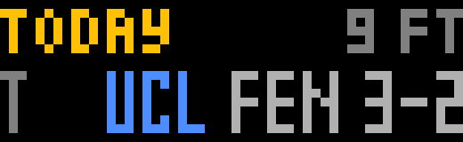
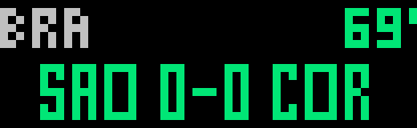

# Matchday

A multi-league live score ticker for the **Ulanzi TC002** pixel clock running [AWTRIX NG](https://github.com/Blueforcer/awtrix-ng).

Champions League on Tuesday and Wednesday, Europa and Conference League on Thursday, the Premier League, La Liga, Bundesliga, Serie A and Ligue 1 at the weekend. There's no schedule to set up: Matchday reads today's fixtures for the leagues you follow and removes itself from the clock's rotation when there are no games.





## Install

You need a TC002 on AWTRIX NG. No API key or server is required.

1. Open your clock's web interface, using its IP address or `http://awtrixng-xxxxxx.local`.
2. On the **Scripts** tab, create a script named `Matchday`.
3. Paste in [`Matchday.ax`](https://github.com/jermdw/jerm_ai_experiments/blob/main/awtrix/matchday/Matchday.ax) and press **Save**.

Or from a terminal, replacing the address with your clock's:

```bash
curl -X PUT "http://awtrixng-xxxxxx.local/api/v1/apps/script/Matchday" -H "Content-Type: text/plain" --data-binary @Matchday.ax
```

## Settings

Go to the **Apps** tab and click the gear on the Matchday row.

| Setting | Default | What it does |
|---|---|---|
| Leagues | UCL, Europa League, Conference League, EPL, La Liga, Bundesliga, Serie A, Ligue 1 | ESPN paths, comma separated |
| Display | `ticker` | `ticker` scrolls every game; `pages` shows one at a time |
| Live refresh | 45 s | How often each live game is re-read |
| Show upcoming | on | Include games that haven't started |
| Show finished | on | Include today's final scores |
| Ticker speed | 120% | Scroll speed |
| Seconds a page | 4 s | Time on each game in pages mode |

In pages mode, turn the knob to step through games.

### Reading the display

- **Green:** live, with the match minute
- **White and amber:** upcoming, with the local kick-off time
- **Grey:** finished
- **`PPD` / `CAN`:** postponed or cancelled
- **`NO SIGNAL`, or a red status in pages mode:** updates have been failing for 5 minutes, so scores may be out of date

### League paths

| League | Path |
|---|---|
| Champions League | `soccer/uefa.champions` |
| Europa League | `soccer/uefa.europa` |
| Conference League | `soccer/uefa.europa.conf` |
| Premier League | `soccer/eng.1` |
| La Liga | `soccer/esp.1` |
| Bundesliga | `soccer/ger.1` |
| Serie A | `soccer/ita.1` |
| Ligue 1 | `soccer/fra.1` |
| MLS | `soccer/usa.1` |

Other ESPN league paths also work, and show a short tag taken from the path.

## How it works

ESPN's league scoreboard runs past 100 KB on a matchday, which is too large to parse on the clock. Matchday instead reads a small list of today's game IDs, then fetches each game on its own (about 13 KB). Measured on a TC002, one game takes about 430 ms to fetch, 8 ms to parse and about 52 KB of temporary memory.

Requests go out one at a time with a gap of at least 2 seconds, so other apps on the clock still get their turn. Finished games are not re-read. If many games are live at once, the time between updates for each game can exceed the Live refresh setting.

## Limitations

- **The data source is unofficial.** Scores come from ESPN's undocumented public endpoints, which can change or stop working without notice. This project isn't affiliated with ESPN.
- **Scores aren't instant.** Expect them to lag the broadcast by a minute or so.
- **A long ticker holds the panel.** Each pass runs to the end before the clock moves to its next app, and new scores appear on the next pass. On a busy Saturday, turn off finished games or use pages mode if that's too long.
- **"Today" follows the clock's local date.** Games still live at midnight stay on screen until they finish.
- **TC002 only.** The layout needs the 52×16 panel.

## Roadmap: NFL and college football

US sports already use the same data path, with the away team listed first. Tested so far with live NBA and NHL games. NFL (`football/nfl`) and college football (`football/college-football`) have not yet been tested during a game. A full college football Saturday can also exceed the app's limit of 60 games a day, so it will need a filter by conference or team.

## License

MIT, see the [repository license](https://github.com/jermdw/jerm_ai_experiments/blob/main/LICENSE). AWTRIX NG itself is licensed separately by its author.
