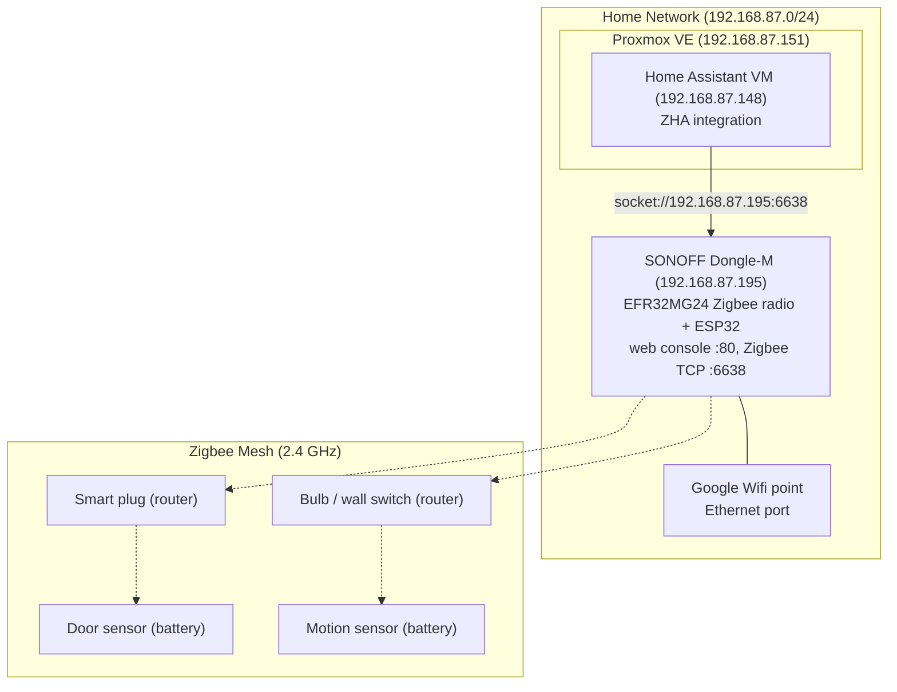

# Home Assistant Zigbee Guide (SONOFF Dongle Max Edition)

Add a Zigbee network to Home Assistant using a **SONOFF Dongle Max (Dongle-M)**, a network-attached Zigbee coordinator. It connects over Ethernet, so Home Assistant reaches it across the network: no USB passthrough into the Proxmox VM, and the radio can sit in the middle of the house instead of next to the server.

---

## Architecture Overview



### Network Map Addition

| Device | IP | Local name | Reached at |
|---|---|---|---|
| SONOFF Dongle Max (Zigbee coordinator) | `192.168.87.195` | `zigbee.lab.seavy.dev` (web console only) | `http://…:80`, Zigbee on TCP `6638` |

> `.195` is the address my router gave the dongle, reserved in [Section 4](#_4-connect-it-and-reserve-its-ip). Following along on a different network? Substitute your own address everywhere `192.168.87.195` appears.

---

## 1. Hardware: What the Dongle Max Is

The Dongle-M is not a plain USB stick. It's a small network device with two chips:

| Chip | Job |
|---|---|
| **Silicon Labs EFR32MG24** | The Zigbee (or Thread) radio |
| **ESP32** | Ethernet, Wi-Fi, the web console, and a TCP bridge to the radio |

Home Assistant talks to the radio through the ESP32 over TCP port `6638`. As far as ZHA is concerned, it looks like a serial port that happens to be on the network.

**Connection and power options:**

| Option | Notes |
|---|---|
| **Ethernet + PoE** (802.3af, 48 V) | One cable for power and data. Needs a PoE switch or injector. Google Wifi points don't supply PoE. |
| **Ethernet + USB-C power** ⭐ | Ethernet for data, any 5 V / 1 A phone charger for power. **The setup used here.** |
| **Wi-Fi + USB-C power** | Works, but puts Zigbee traffic on 2.4 GHz Wi-Fi, which shares airspace with Zigbee. Use only if there's no cable where you want the radio. |
| **USB to the server** | Works like a regular USB dongle, but gives up the main advantage. Avoid. |

> 💡 **Why network-attached beats USB on Proxmox:** a USB dongle on the Proxmox host has to be passed through to the Home Assistant VM, and it ties the radio to the server's location, usually a closet or a corner. USB 3.0 ports and the server's own electronics also make radio noise right next to the antenna. A network coordinator avoids all three problems, and the Home Assistant VM can move or be restored to new hardware without touching the dongle.

---

## 2. ZHA vs Zigbee2MQTT

| | **ZHA** ⭐ | **Zigbee2MQTT** |
|---|---|---|
| Install | Built into Home Assistant | Separate Mosquitto broker + Zigbee2MQTT add-on |
| Setup effort | A few clicks | More configuration |
| Device support | Very good | Broadest, often supports new devices first |
| Fine control | Basic | Detailed per-device options, its own web UI |
| Dongle-M radio setting | Radio type **EZSP** | Adapter **`ember`** |

**This guide uses ZHA.** It's the simplest place to start. Switching to Zigbee2MQTT later means re-pairing every device, so if you think you'll want it, decide before you pair many devices. Zigbee2MQTT settings are in [Section 8](#_8-optional-zigbee2mqtt-instead-of-zha).

---

## 3. Placement

Zigbee is a **mesh**: mains-powered devices (plugs, bulbs, wall switches) repeat signals for battery devices. The coordinator is the root of the mesh, so place it well:

- **Central**, roughly in the middle of the house, ideally up off the floor.
- **At least 1–2 m from a Google Wifi point** and other 2.4 GHz sources (microwaves, USB 3.0 drives, the server itself). The included 1 m USB extension helps if you power it from a USB port near something noisy.
- **Antennas vertical.** The dual 5 dBi antennas radiate sideways, in a donut shape around the antenna.
- Expect **about 6–8 m (20–25 ft) of reliable direct range indoors**. Plan on routers to reach further.

---

## 4. Connect It and Reserve Its IP

1. Plug the dongle's Ethernet port into a **Google Wifi point's LAN port** (or a switch connected to one).
2. Power it with USB-C, or use PoE if you have a PoE switch.
3. In the **Google Home app → Wi-Fi → Devices**, find the new device. It usually shows up as `Dongle-M` or `SONOFF…`, sometimes unnamed; match it by MAC address.
4. **Reserve its IP:** Google Home app → **Wi-Fi** → **Settings** → **Advanced networking** → **DHCP IP reservations** → **+**. Keep the address it already has (here `192.168.87.195`). If you pick a different address, unplug and replug the dongle so it picks up the reservation.

> 🔒 **Why the reservation is required:** Home Assistant connects to the coordinator by IP. If the dongle gets a new address after a power cut, ZHA can't reach it, and every Zigbee device in the house goes unavailable at once. See Section 5, *Reserve IP Addresses*, in the [Local DNS guide](home-network-local-dns.md) for the full process.

### Optional: a friendly name for the web console

The wildcard rewrite `*.lab.seavy.dev → 192.168.87.158` from the [Local DNS guide](home-network-local-dns.md) sends every `lab` name to Nginx Proxy Manager. So for `https://zigbee.lab.seavy.dev`, add a **proxy host** in NPM:

| Field | Value |
|---|---|
| Domain Names | `zigbee.lab.seavy.dev` |
| Scheme | `http` (the console serves plain HTTP; `https` here causes a **502 Bad Gateway**) |
| Forward Hostname / IP | `192.168.87.195` |
| Forward Port | `80` |
| Cache Assets | Off |
| Block Common Exploits | ✅ |
| Websockets Support | ✅ Harmless, and keeps any live status or log views updating |

**SSL tab:** the `*.lab.seavy.dev` wildcard certificate, with **Force SSL** and **HTTP/2 Support** on.

No AdGuard change is needed: the existing wildcard rewrite already sends `zigbee.lab.seavy.dev` to NPM.

> ⚠️ **Use the IP, not this name, in ZHA.** `zigbee.lab.seavy.dev` resolves to the proxy, and the proxy only forwards web traffic. ZHA's raw TCP connection on port `6638` would hit NPM and fail.

---

## 5. First Run: Web Console and Firmware

Open `http://192.168.87.195` in a browser.

1. **Set an admin password** if prompted.
2. **Update the system (ESP32) firmware** from the console's firmware/update page.
3. **Update the Zigbee (EFR32MG24) firmware** to the latest **Zigbee Coordinator** build.
4. Under **EFR32MG24 Operation Mode**, choose **Zigbee Coordinator**. The other modes are Zigbee Router, Thread RCP, and MultiPAN (beta); don't use them for this setup.
5. **Click Reboot Dongle-M.** Changing modes doesn't reboot it automatically, and port `6638` refuses connections until it reboots.
6. Note the **Zigbee TCP port** shown in the console. It should be `6638`.

> 💡 **Why not MultiPAN (Zigbee + Thread on one radio)?** It sounds convenient, but Home Assistant has retired its multiprotocol add-on, and ZHA doesn't support the MultiPAN firmware. If you want Thread or Matter later, use a second dongle as a dedicated Thread radio and keep this one on Zigbee.

---

## 6. Add It to Home Assistant (ZHA)

Home Assistant sometimes discovers the dongle on the network. Check **Settings → Devices & services** for a discovered **Zigbee** card. If one appears, click **Configure** and check that the path it shows matches the one below.

To add it manually:

1. **Settings → Devices & services → Add Integration → Zigbee Home Automation**
2. Serial device: **Enter manually**
3. Radio type: **EZSP** (Silicon Labs EmberZNet)
4. Serial port settings:

| Field | Value |
|---|---|
| Serial device path | `socket://192.168.87.195:6638` |
| Port speed | `115200` |
| Data flow control | `software` (not hardware) |

5. **Create a network** (or **Restore an automatic backup** if you're migrating, see below).

ZHA picks a Zigbee channel and generates a network key. When it finishes, you'll see the coordinator as the only device.

> 💡 **`socket://` vs `tcp://`:** SONOFF's own instructions write the path as `tcp://Dongle-M.local:6638`. ZHA's documented format for network coordinators is `socket://`. Use `socket://` with the IP; the mDNS name `Dongle-M.local` works too, but an IP avoids mDNS lookup problems inside the VM.

### Migrating from an existing ZHA coordinator

If you already have a Zigbee network on a USB dongle:

1. **Settings → Devices & services → Zigbee Home Automation → Configure → Migrate radio**
2. Choose **Migrate automatically** (or download a backup first, which is always a good idea).
3. Point it at the Dongle-M with the settings above.

ZHA copies the network key, PAN ID and channel to the new radio, so devices keep working without re-pairing. Unplug the old dongle afterwards. Two coordinators with the same network identity will fight each other.

---

## 7. Pair Devices and Build the Mesh

**Settings → Devices & services → Zigbee Home Automation → Add device**, then put the device into pairing mode:

| Device type | Usual pairing method |
|---|---|
| Bulbs | Power on/off 5–6 times |
| Plugs / switches | Hold the button 5–10 s until the LED flashes |
| Battery sensors | Hold the pairing/reset button (often with a pin) for 5 s |

**Order matters:**

1. **Pair mains-powered routers first**, spread around the house. Plugs, bulbs, and in-wall switches with a neutral wire usually route; battery devices never do.
2. **Pair battery devices where they'll live**, not next to the coordinator. They attach to the nearest router when they join and may stay attached to it.
3. **Give the mesh time.** After adding routers, wait an hour or two (or restart HA overnight) for routes to settle before judging range.

**Check the mesh:** ZHA → **Configure** → **Visualization** shows which devices route through which. Links with a low LQI (link quality, 0–255) are the first place to add a router.

> 💡 **Zigbee and Wi-Fi channels:** both use 2.4 GHz. Zigbee channels **15, 20 and 25** sit mostly between Wi-Fi channels 1, 6 and 11. ZHA chooses a channel when it creates the network, and you can see it under ZHA → **Configure**. If you have constant drop-outs, check the Wi-Fi channels your Google Wifi points use before blaming the dongle.

---

## 8. Optional: Zigbee2MQTT Instead of ZHA

Don't run both. The dongle accepts **only one TCP connection** at a time, so whichever connects first locks the other out.

Install the **Mosquitto broker** and **Zigbee2MQTT** add-ons, then set the Zigbee2MQTT serial configuration:

```yaml
serial:
  port: tcp://192.168.87.195:6638
  baudrate: 115200
  adapter: ember
  rtscts: false
```

`ember` is Zigbee2MQTT's current driver for Silicon Labs radios. The older `ezsp` driver is deprecated.

---

## 9. Backups

Your Zigbee network identity (network key, PAN ID, channel) lives on the coordinator. If the dongle dies and there's no backup, **every device has to be re-paired**.

- **ZHA backs up automatically** into Home Assistant's own backups. Make sure HA backups run regularly and are stored off the VM (for example a Proxmox backup of the VM, or HA's backup to network storage).
- **Manual backup:** ZHA → **Configure** → **Download backup**. Do this before firmware updates and before migrating.
- Restoring onto a new coordinator uses the same **Migrate radio** flow as [Section 6](#migrating-from-an-existing-zha-coordinator).

---

## 10. Troubleshooting

| Symptom | Likely cause | Fix |
|---|---|---|
| ZHA setup fails: "Failed to connect" | Wrong IP/port, or the mode change wasn't followed by a reboot | Confirm the IP and port `6638` in the web console, then click **Reboot Dongle-M** |
| Connection refused after changing operation mode | Mode change doesn't reboot the dongle | **Reboot Dongle-M** from the web console |
| `nc`/`telnet` to port 6638 fails while HA works | Only one TCP client allowed | Normal. Stop ZHA/Z2M before testing the port by hand |
| All Zigbee devices unavailable after a power cut | Dongle came back on a different IP | Add the DHCP reservation ([Section 4](#_4-connect-it-and-reserve-its-ip)) |
| Z2M logs `Waiting for RSTACK` or `HOST_FATAL_ERROR` after a firmware update | Radio stuck after updating while connected | Stop Z2M, switch the mode to **Thread RCP**, then back to **Zigbee Coordinator**, reboot, start Z2M |
| Devices far away drop off | Not enough routers | Add mains-powered routers between the coordinator and those devices |
| Battery sensor works next to the dongle, fails in place | It joined near the coordinator and kept that route | Re-pair it in its final location |
| Web console shows the year 1970 | The dongle's NTP sync isn't working | Cosmetic. Zigbee doesn't depend on the dongle's clock |

### Test the port from the Proxmox host

With ZHA **stopped** (single-connection limit):

```bash
nc -vz 192.168.87.195 6638
```

`succeeded` means the dongle is listening. `Connection refused` means it needs a reboot or isn't in Zigbee Coordinator mode.

---

## 11. Maintenance

- **Firmware:** check the web console every few months. Download a ZHA backup first, stop ZHA or Z2M (ZHA: **Settings → Devices & services → Zigbee Home Automation → ⋮ → Disable**), update, reboot the dongle, then re-enable.
- **Device firmware:** ZHA can update supported devices over the air. They show up as normal Home Assistant **Updates**.
- **Adding devices later:** always pair new routers before battery devices in the same area.

---

## 12. Optional: Bluetooth from the Proxmox Host's Built-in Adapter

Many mini PCs (the Beelink N100 boxes included) have Bluetooth on the same card as Wi-Fi. Home Assistant can use it for Bluetooth sensors (thermometers, plant sensors, presence tags), but it runs in a VM, so the adapter has to be passed through from the Proxmox host first.

**1. Find the adapter**

> 📍 **Run on:** Proxmox host shell (`root@pve`)

```bash
lsusb | grep -i bluetooth
```

```text
Bus 003 Device 002: ID 8087:0026 Intel Corp. AX201 Bluetooth
```

Then find its **USB port path** (here `3-10`):

```bash
for d in /sys/bus/usb/devices/*; do
  [ -f $d/idVendor ] && [ "$(cat $d/idVendor):$(cat $d/idProduct)" = "8087:0026" ] && basename $d
done
```

No Bluetooth line? The mini PC doesn't have it, or it's turned off in the BIOS. Use a USB adapter or ESPHome proxies (below) instead.

**2. Stop the host from using the adapter**

```bash
echo "blacklist btusb" > /etc/modprobe.d/blacklist-btusb-passthrough.conf
modprobe -r btusb
```

> [!IMPORTANT]
> **Don't skip this step with Intel adapters.** They start in a bootloader mode, and the driver uploads firmware to switch them into normal mode. If the host's driver does that first, the VM's driver can't do it again: Home Assistant logs `Bluetooth: hci0: FW download error recovery failed (-19)` and the adapter may stop responding on the host's USB port until it's reset. Blocking `btusb` on the host leaves the firmware upload to Home Assistant. Nothing on a Proxmox host normally uses Bluetooth, and Wi-Fi uses a separate driver.

**3. Pass it through by port and restart the VM**

```bash
cp /etc/pve/qemu-server/<ha-vmid>.conf /root/<ha-vmid>.conf.bak
qm shutdown <ha-vmid>
qm set <ha-vmid> -usb0 host=3-10
qm start <ha-vmid>
```

Pass it through **by port** (`host=3-10`), not by ID (`host=8087:0026`). The chip disconnects and reconnects while it switches from bootloader to normal mode, and a port passthrough follows it through that reset. A built-in adapter is soldered to the board, so its port never changes.

**4. Check that Home Assistant has it**

> 📍 **Run on:** Proxmox host shell (needs the QEMU guest agent, which Home Assistant OS includes)

```bash
qm guest exec <ha-vmid> -- sh -c "ls /sys/class/bluetooth; dmesg | grep hci0 | tail -5"
```

`hci0` and lines such as `Fseq status: Success` mean the firmware loaded. Then, in Home Assistant, open **Settings → Devices & services**. **Bluetooth** appears under **Discovered**. Click **Add**. If it isn't there, use **+ Add integration → Bluetooth**.

**If it still fails:** the adapter is probably stuck after an earlier attempt. Reset the USB controller it's on, but only if nothing else is plugged into that controller (check with `lsusb`). With the VM stopped:

```bash
pci=$(basename $(readlink -f /sys/bus/usb/devices/usb3/..))   # usb3 = the adapter's bus number
echo $pci > /sys/bus/pci/drivers/xhci_hcd/unbind; sleep 3
echo $pci > /sys/bus/pci/drivers/xhci_hcd/bind
lsusb | grep -i bluetooth                                      # should be back
```

Then start the VM again. A full reboot of the Proxmox host does the same thing.

**To undo it:** `qm set <ha-vmid> -delete usb0`, delete `/etc/modprobe.d/blacklist-btusb-passthrough.conf`, and reboot the host.

> 💡 **Range:** a built-in adapter sits inside a small metal case, usually next to the router, so it often won't reach sensors in other rooms. Don't add a USB adapter to fix that. Flash a few **ESP32 boards ($8–15 each) as ESPHome Bluetooth proxies** and plug them into USB chargers around the house. They relay Bluetooth to Home Assistant over Wi-Fi, and Home Assistant combines every proxy and the built-in adapter into one Bluetooth network.
