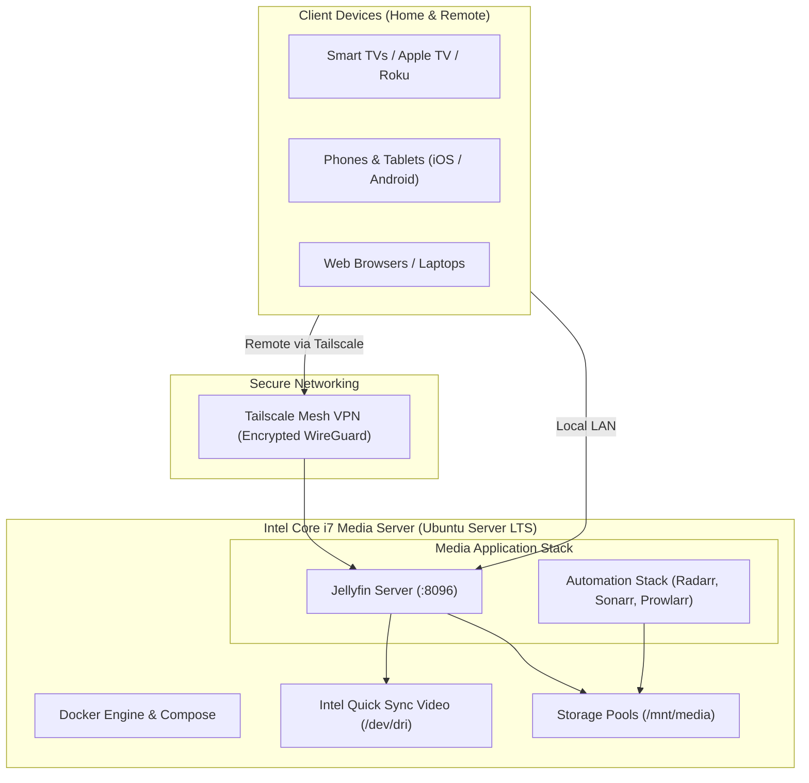
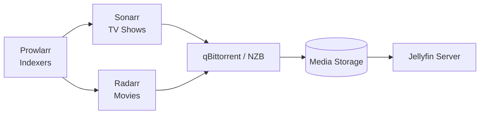

# Home Media Server Setup Guide (Old Intel i7 Edition)

A complete, battle-tested guide to transforming an old Intel Core i7 PC into a whisper-quiet, power-efficient, 24/7 home media streaming server using Ubuntu Server, Docker, and Jellyfin with hardware-accelerated transcoding.

---

## Architecture Overview



---

## 1. Hardware Assessment: Intel Quick Sync (QSV)

Repurposing an Intel Core i7 desktop or small form factor (SFF) machine is ideal because Intel integrated graphics (iGPU) feature **Intel Quick Sync Video**. Quick Sync offloads video decoding and encoding from the CPU cores to dedicated silicon on the graphics die, allowing multiple simultaneous 1080p/4K transcoded streams with negligible CPU usage and minimal power consumption.

### Codec Support by Intel Core Generation

| Generation | Code Name | Example CPU | H.264 (AVC) | H.265 (HEVC) 8-bit | H.265 (HEVC) 10-bit | AV1 Decode |
| :--- | :--- | :--- | :---: | :---: | :---: | :---: |
| **4th Gen** | Haswell | i7-4770, i7-4790 | Full | No | No | No |
| **6th Gen** | Skylake | i7-6700 | Full | Full (Decode/Encode) | No | No |
| **7th–10th Gen** | Kaby Lake / Comet Lake | i7-7700, i7-8700, i7-10700 | Full | Full | **Full (4K HDR)** | No |
| **11th+ Gen** | Tiger / Alder Lake | i7-11700, i7-12700 | Full | Full | Full | **Full** |

> [!NOTE]
> Even if your i7 is 4th–6th Gen, it will easily handle 1080p H.264 transcoding. For modern 4K HDR HEVC files, 7th Gen or newer can transcode multiple 4K 10-bit streams without breaking a sweat.

---

## 2. Distribution Selection

| Distribution | Best Suited For | Pros | Considerations |
| :--- | :--- | :--- | :--- |
| **Ubuntu Server LTS (24.04)** *(Recommended)* | Dedicated media server & Docker containers | Up-to-date Intel GPU kernel drivers (`i915`), huge community, rock-solid stability, zero desktop bloat. | Managed via CLI/SSH (no default desktop GUI). |
| **Debian 12 (Bookworm)** | Minimalist purists | Maximum stability, very low resource footprint. | Non-free firmware package installation required during setup for Intel drivers. |
| **TrueNAS SCALE** | Storage-first NAS builds | Enterprise ZFS pools, dataset management, web-based admin interface. | Requires matched disk layouts; higher RAM overhead (minimum 8–16 GB for ZFS). |
| **Unraid** | Mixed drive sizes | Allows adding drives of different sizes at any time; single parity drive. | Paid license; boots and runs off an active USB flash drive. |
| **Proxmox VE** | Multi-purpose Homelabs | Run media server inside an LXC container alongside other VMs. | Additional complexity passing the iGPU (`/dev/dri`) into an LXC container. |

---

## 3. BIOS & Pre-Installation Tuning

Before installing the operating system, boot into your PC's BIOS/UEFI (usually by tapping `Del`, `F2`, or `F12` during boot):

1. **Enable Integrated Graphics (iGPU)**:
   * Look for **Primary Graphics Adapter** or **IGPU Multi-Monitor**.
   * Set it to **Enabled** (or **IGPU**). Do not disable it if you have a discrete GPU installed; the media server needs access to Intel Quick Sync.
2. **AC Power Recovery**:
   * Navigate to Power Management and locate **Restore on AC Power Loss**.
   * Set this to **Power On** (or **Last State**). If your power flickers or cuts out, the server will automatically boot back up once power is restored.
3. **Disable Deep Sleep / C-States Issues**:
   * Disable **EuP / ErP Ready** and sleep states to prevent the network interface card (NIC) from sleeping.
4. **Wake-on-LAN (WoL)**:
   * Optional: Enable Wake-on-LAN if you want the ability to send magic packets across your network to wake the machine.

---

## 4. Base Operating System Installation

1. Download **[Ubuntu Server 24.04 LTS ISO](https://ubuntu.com/download/server)**.
2. Flash the ISO to a USB flash drive using [BalenaEtcher](https://etcher.balena.io/) or [Rufus](https://rufus.ie/).
3. Connect the server to your router using an Ethernet cable (avoid Wi-Fi for media streaming servers).
4. Boot from the installer USB and follow the prompts:
   * Choose your preferred language and keyboard layout.
   * **Base Installation**: Choose standard Ubuntu Server (minimized is fine too).
   * **Network**: Keep DHCP for now (we recommend assigning a static IP in your router's DHCP reservation table).
   * **Storage**: Select your primary system disk (preferably an internal SSD/NVMe).
   * **SSH Setup**: Check the box for **Install OpenSSH Server** (critical for headless administration).
   * **Package Selection**: Skip the pre-bundled snaps; we will install official Docker directly.

After installation completes, reboot, remove the USB drive, and log in via your terminal from another computer:

```bash
ssh username@<server-ip>
```

Update all packages:
```bash
sudo apt update && sudo apt upgrade -y
sudo apt install -y curl wget git htop iotop ufw
```

---

## 5. Storage Configuration & Automatic Mounting

Your media files (movies, TV shows, music) should live on a dedicated hard drive or external enclosure.

### Identifying the Drive
Run `lsblk` to list block devices:

```bash
lsblk -f
```

Identify the partition (e.g. `/dev/sdb1`) and note its **UUID** and **FSTYPE** (e.g. `ext4`, `xfs`, `ntfs`).

### Creating the Mount Point & Configuring fstab
Create a persistent mount directory:

```bash
sudo mkdir -p /mnt/media
```

Get the UUID:
```bash
sudo blkid /dev/sdb1
```

Edit `/etc/fstab` to automatically mount the drive at boot:
```bash
sudo nano /etc/fstab
```

Add the following line at the end (replace the UUID and filesystem type with yours):

```text
# Media drive mount
UUID=YOUR-DRIVE-UUID-HERE /mnt/media ext4 defaults,noatime,nofail 0 2
```

> [!TIP]
> The `nofail` flag prevents the server from hanging at the emergency boot screen if the external/secondary drive is disconnected or fails to spin up during boot.

Test the mount without rebooting:
```bash
sudo mount -a
df -h /mnt/media
```

Create folder structure and set permissions:
```bash
sudo mkdir -p /mnt/media/movies /mnt/media/tv /mnt/media/music
sudo chown -R $USER:$USER /mnt/media
```

---

## 6. Docker & Docker Compose Setup

Install the official Docker Engine directly from Docker's official apt repository:

```bash
# Set up Docker repository
sudo install -m 0755 -d /etc/apt/keyrings
curl -fsSL https://download.docker.com/linux/ubuntu/gpg | sudo gpg --dearmor -o /etc/apt/keyrings/docker.gpg
sudo chmod a+r /etc/apt/keyrings/docker.gpg

echo \
  "deb [arch=$(dpkg --print-architecture) signed-by=/etc/apt/keyrings/docker.gpg] https://download.docker.com/linux/ubuntu \
  $(. /etc/os-release && echo "$VERSION_CODENAME") stable" | \
  sudo tee /etc/apt/sources.list.d/docker.list > /dev/null

# Install Docker engine and compose plugin
sudo apt update
sudo apt install -y docker-ce docker-ce-cli containerd.io docker-buildx-plugin docker-compose-plugin

# Grant your user permission to run docker without sudo
sudo usermod -aG docker $USER
newgrp docker
```

Verify the installation:
```bash
docker compose version
```

---

## 7. Intel Quick Sync Configuration

Install the user-mode VA-API drivers and diagnostic utilities:

```bash
sudo apt install -y vainfo intel-media-va-driver-non-free
```

Verify that the Intel GPU device nodes exist:
```bash
ls -l /dev/dri
```

You should see:
* `/dev/dri/card0`
* `/dev/dri/renderD128`

Add your user to the `render` and `video` groups:
```bash
sudo usermod -aG render,video $USER
```

Find the group ID for `render` (usually `107` or `108` on Ubuntu):
```bash
getent group render | cut -d: -f3
```
*Take note of this number; you will pass it into your Docker Compose file.*

Verify driver capabilities with `vainfo`:
```bash
vainfo
```
You should see a list of supported entry points like `VAProfileH264High : VAEntrypointVLD` and `VAEntrypointEncSlice`.

---

## 8. Jellyfin Media Server Deployment

Create a dedicated directory for your media stack:

```bash
mkdir -p ~/media-server
cd ~/media-server
```

Create `docker-compose.yml`:

```bash
nano docker-compose.yml
```

Paste the following configuration:

```yaml
services:
  jellyfin:
    image: jellyfin/jellyfin:latest
    container_name: jellyfin
    user: 1000:1000  # Run `id -u` and `id -g` to check your UID:GID
    network_mode: host
    group_add:
      - "107"        # Replace with output of: getent group render | cut -d: -f3
    devices:
      - /dev/dri:/dev/dri  # Intel Quick Sync hardware passthrough
    volumes:
      - ./config:/config
      - ./cache:/cache
      - /mnt/media:/media:ro  # Read-only access to your media files
    environment:
      - TZ=America/New_York   # Set to your local timezone
      - JELLYFIN_PublishedServerUrl=http://192.168.1.100:8096 # Optional: server IP
    restart: unless-stopped
```

Start the container in detached mode:

```bash
docker compose up -d
```

Check the logs to verify startup:
```bash
docker compose logs -f jellyfin
```

---

## 9. Configuring Jellyfin & Hardware Acceleration

1. Open your browser and navigate to:
   ```text
   http://<server-ip>:8096
   ```
2. Follow the setup wizard:
   * Choose preferred display language.
   * Create an administrative username and password.
   * Add your media libraries (`/media/movies` for Movies, `/media/tv` for Shows).
3. Once logged in, click the **Hamburger Menu (top left) -> Dashboard**.
4. In the left navigation, select **Playback** -> **Transcoding**:
   * **Hardware acceleration**: Select **Intel QuickSync (QSV)**.
   * **Enable hardware decoding for**: Check the formats supported by your CPU generation:
     * H.264
     * HEVC / H.265 (Check 10-bit if 7th Gen or newer)
     * VC1, MPEG2, VP8, VP9 (as applicable)
   * **Hardware encoding options**:
     * Check **Enable Hardware Encoding**.
     * Check **Allow HEVC encoding** (if supported).
   * **VPP Tone Mapping**: Check **Enable VPP Tone mapping** (handles HDR to SDR color conversion cleanly on Intel iGPUs).
5. Scroll down and click **Save**.

### Testing Transcoding
Play any high-bitrate video in the browser, change playback quality from "Auto" to "1080p - 3 Mbps" or "720p".
Open another terminal on your server and inspect GPU usage:

```bash
sudo apt install -y intel-gpu-tools
sudo intel_gpu_top
```
You will see the **Video** engine engage with active workload, while CPU usage remains around 2–5%!

---

## 10. Secure Remote Access (Tailscale)

Never expose port 8096 directly to the open internet via router port forwarding without a reverse proxy, SSL, and authentication hardening.

The simplest, zero-configuration solution is **Tailscale** (a peer-to-peer WireGuard VPN):

1. Install Tailscale on the server:
   ```bash
   curl -fsSL https://tailscale.com/install.sh | sh
   sudo tailscale up
   ```
2. Click the authentication link in the terminal to connect the server to your Tailscale network.
3. Install the Tailscale app on your phone, laptop, or remote streaming device.
4. You can now access your Jellyfin server securely from anywhere in the world using its Tailscale IP or MagicDNS name:
   ```text
   http://100.x.y.z:8096
   ```

---

## 11. Optional: Expanding with the Media Automation Stack

To automate downloading, organizing, metadata scraping, and subtitles, expand your `docker-compose.yml` to include the popular companion containers:



* **Radarr**: Automatic movie downloader and organizer.
* **Sonarr**: Automatic TV series downloader and organizer.
* **Prowlarr**: Centralized indexer and tracker manager.
* **Bazarr**: Subtitle downloader.
* **Jellyseerr**: Polished discovery and request interface for household members.
* **Gluetun**: VPN client container to ensure torrent download traffic stays private.

---

## 12. Maintenance & Useful Commands

### Checking System Resource Usage
```bash
htop                # CPU and RAM overview
df -h               # Storage capacity check
sudo intel_gpu_top  # Intel GPU transcoding monitor
```

### Updating Jellyfin
```bash
cd ~/media-server
docker compose pull
docker compose up -d
```

### Clean up unused Docker images & cache
```bash
docker system prune -a
```
