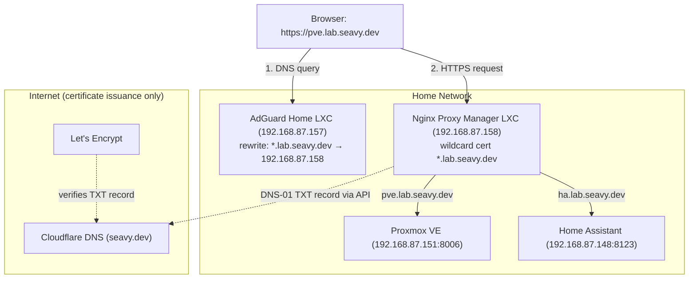

# Home Network Local DNS Guide (seavy.dev Edition)

Type `pve.lab.seavy.dev` instead of `https://192.168.87.151:8006` for every service on the home network. This guide uses AdGuard Home for local DNS and Nginx Proxy Manager as a reverse proxy. A wildcard Let's Encrypt certificate is issued through Cloudflare's DNS API, so every service gets a trusted HTTPS padlock and no ports are opened to the internet.

---

## Architecture Overview



### Network Map

This guide uses the real addresses on my network: a Google Wifi router (`192.168.87.0/24`) behind an AT&T Fiber gateway. Every address below has a **DHCP reservation** so it never changes (see [Section 5](#_5-reserve-ip-addresses)).

| Device | IP | Local name | Reached at |
|---|---|---|---|
| Google Wifi router | `192.168.87.1` | — | Google Home app |
| Proxmox VE host | `192.168.87.151` | `pve.lab.seavy.dev` | `https://…:8006` |
| Home Assistant | `192.168.87.148` | `ha.lab.seavy.dev` | `http://…:8123` |
| AdGuard Home (LXC) | `192.168.87.157` | `adguard.lab.seavy.dev` | `http://…:80` (setup wizard on `:3000`) |
| Nginx Proxy Manager (LXC) | `192.168.87.158` | `npm.lab.seavy.dev` | `http://…:81` |
| Netronome (LXC) | `192.168.87.159` | — | |
| VictoriaLogs (LXC) | `192.168.87.160` | — | |
| go2rtc (LXC) | `192.168.87.161` | — | |
| TC002 Now Playing (LXC) | `192.168.87.146` | — | |
| AWTRIX clock (Ulanzi TC002) | `192.168.87.141` | — | `http://…:80` |

> Following along on a different network? Substitute your own addresses everywhere `192.168.87.x` appears.

---

## 1. Why Not `.local`?

`.local` is reserved for **mDNS** (Bonjour/Avahi, RFC 6762). macOS, iOS, and most Linux systems send any `*.local` lookup to multicast instead of your DNS server. The result is inconsistent: names work on some devices, fail on others, or take several seconds to resolve.

| Suffix | Verdict |
|---|---|
| `.local` | ❌ Conflicts with mDNS |
| `home.arpa` | ✅ The official reserved name for home networks (RFC 8375), but you can't get trusted certificates for it |
| `.internal` / `.lan` | ⚠️ They resolve fine, but you can't get trusted certificates for them |
| **A subdomain of a domain you own** (`lab.seavy.dev`) | ✅ **Best option:** real, publicly trusted HTTPS certificates |

### Why a subdomain (`lab.`) instead of the bare domain?

Putting home services under `*.lab.seavy.dev` keeps `seavy.dev` and `www.seavy.dev` free for anything public later. A local wildcard on the bare domain (`*.seavy.dev`) would override any public subdomains for devices on your network.

---

## 2. Comparing Local DNS Options

| Option | Pros | Cons |
|---|---|---|
| **Router DNS** (UniFi, OPNsense, pfSense, OpenWrt) | Nothing new to run | Most ISP routers don't support it |
| **Pi-hole** | Popular, blocks ads | Wildcards need a manual dnsmasq config file |
| **AdGuard Home** ⭐ | Clean UI, **wildcard DNS rewrites** built in, encrypted upstreams | One more service to keep running |
| **Technitium DNS** | Full authoritative DNS server, good for learning | More than most home labs need |
| `/etc/hosts` | Zero setup | Edited per machine, doesn't work on phones |
| **Tailscale MagicDNS** | Works away from home | Only covers devices on your Tailscale network |

**This guide uses AdGuard Home** because of its wildcard rewrites: a single rule covers every current and future service.

---

## 3. Important: `.dev` Is HTTPS-Only

Every `.dev` domain is on the browser **HSTS preload list**. Chrome, Firefox, Safari, and Edge refuse to load any `.dev` site over plain `http://`. Valid TLS certificates are a requirement here, not an extra. The reverse proxy and wildcard certificate below handle this.

---

## 4. Create a Cloudflare API Token

Nginx Proxy Manager uses this token to create temporary TXT records that prove to Let's Encrypt you own the domain.

1. Cloudflare dashboard → **My Profile** → **API Tokens** → **Create Token**
2. Choose the **Edit zone DNS** template
3. Configure it:
   - **Permissions:** `Zone` → `DNS` → `Edit`
   - **Zone Resources:** `Include` → `Specific zone` → `seavy.dev`
4. Create the token and **copy it somewhere safe**. Cloudflare only shows it once.

> 🔒 Scoping the token to a single zone means a leaked token can only edit DNS for `seavy.dev`, not your whole Cloudflare account.

---

## 5. Reserve IP Addresses

DNS records and proxy hosts point at fixed IPs, so a device that gets a new address from DHCP after a reboot breaks them. Give every homelab device a **DHCP reservation** on the router.

**Google Wifi / Nest Wifi:** Google Home app → **Wi-Fi** → **Settings** → **Advanced networking** → **DHCP IP reservations** → **+**, choose the device, keep its current IP, and save.

- Match devices by **MAC address**. Proxmox VMs and containers all start with `bc:24:11`. ESP32 devices like the AWTRIX clock often show up unnamed.
- Leave Proxmox containers on **DHCP** in the helper scripts and reserve them here, so every address is managed in one place.
- The Proxmox host sets its own static IP during install. Reserve it anyway so the router never hands `.151` to another device.
- Reserve **AdGuard (`.157`) and Nginx Proxy Manager (`.158`) first**. If either moves, DNS or the proxy breaks for the whole house.
- If a device uses a randomized ("private") Wi-Fi MAC address, turn that off or the reservation won't stick.

---

## 6. Install AdGuard Home (Proxmox LXC)

Run this from the Proxmox host shell (**Datacenter → your node → Shell**). It uses the community-maintained [Proxmox VE Helper-Scripts](https://community-scripts.github.io/ProxmoxVE/). Read the script before running it.

```bash
bash -c "$(curl -fsSL https://raw.githubusercontent.com/community-scripts/ProxmoxVE/main/ct/adguard.sh)"
```

- Accept the defaults (DHCP), then reserve the container's IP on the router. Here it's `192.168.87.157`. Every device will use this address for DNS, so it must never change.
- Open `http://192.168.87.157:3000` to run the setup wizard:
  - **Admin web interface:** all interfaces, port **80**
  - **DNS server:** all interfaces, port **53**
  - Create an admin username and password
- After setup the dashboard moves to `http://192.168.87.157`, and port 3000 stops responding.

### Recommended upstream DNS servers

**Settings → DNS settings → Upstream DNS servers:**

```text
https://dns.cloudflare.com/dns-query
https://dns.quad9.net/dns-query
```

- Choose **Parallel requests**.
- **Bootstrap DNS servers:** `1.1.1.1` and `9.9.9.9`. AdGuard uses these to look up the DoH servers' own hostnames.
- Click **Test upstreams**, then **Apply**.

---

## 7. Add the Wildcard DNS Rewrite

**Filters → DNS rewrites → Add DNS rewrite:**

| Domain | Answer |
|---|---|
| `*.lab.seavy.dev` | `192.168.87.158` (Nginx Proxy Manager IP) |
| `lab.seavy.dev` | `192.168.87.158` |

Every `*.lab.seavy.dev` name now resolves to the reverse proxy, which routes each request to the right service by hostname.

> 💡 **Why DNS alone isn't enough:** DNS maps a name to an IP address, never to a port. Proxmox is on `:8006` and Home Assistant is on `:8123`, so without a proxy you would still be typing ports. The proxy reads the requested hostname and forwards to the correct port.

---

## 8. Install Nginx Proxy Manager (Proxmox LXC)

From the Proxmox host shell:

```bash
bash -c "$(curl -fsSL https://raw.githubusercontent.com/community-scripts/ProxmoxVE/main/ct/nginxproxymanager.sh)"
```

- Accept the defaults (DHCP), then reserve the container's IP on the router. Here it's `192.168.87.158`.
- Open the admin UI at `http://192.168.87.158:81`. Port 3000 on this container is NPM's internal API, not the UI. Check the helper script's output for the default login, then change it right away.

---

## 9. Issue the Wildcard Certificate

**SSL Certificates → Add SSL Certificate → Let's Encrypt:**

1. **Domain Names:** `*.lab.seavy.dev` and `lab.seavy.dev`
2. Turn on **Use a DNS Challenge**
3. **DNS Provider:** Cloudflare
4. **Credentials File Content:**
   ```ini
   dns_cloudflare_api_token = <your-token-here>
   ```
5. Agree to the Let's Encrypt terms and save. Issuance takes about 30 to 60 seconds.

Nginx Proxy Manager renews the certificate automatically before its 90-day expiry using the same token.

> 💡 **Why this works for private services:** the DNS-01 challenge only checks a TXT record in public DNS. Let's Encrypt never connects to your server, so a service that's only reachable on your home network still gets a publicly trusted certificate.

---

## 10. Add Proxy Hosts

**Hosts → Proxy Hosts → Add Proxy Host.** Repeat for each service.

### Proxmox VE

| Field | Value |
|---|---|
| Domain Names | `pve.lab.seavy.dev` |
| Scheme | `https` (Proxmox serves its own self-signed certificate) |
| Forward Hostname / IP | `192.168.87.151` (your Proxmox host) |
| Forward Port | `8006` |
| Websockets Support | ✅ **Required** for the noVNC/xterm.js console |
| Block Common Exploits | ✅ |

**SSL tab:** select the `*.lab.seavy.dev` certificate and turn on **Force SSL** and **HTTP/2 Support**.

### Home Assistant

| Field | Value |
|---|---|
| Domain Names | `ha.lab.seavy.dev` |
| Scheme | `http` (Home Assistant serves plain HTTP; `https` here causes a **502 Bad Gateway**) |
| Forward Hostname / IP | `192.168.87.148` |
| Forward Port | `8123` |
| Websockets Support | ✅ **Required.** Without it HA loads but shows "Unable to connect" |
| Block Common Exploits | ✅ |

**SSL tab:** the same wildcard certificate, with **Force SSL** and **HTTP/2 Support** on.

Home Assistant rejects proxied requests with **400: Bad Request** until it trusts the proxy. Add this to `configuration.yaml` (the **File editor** add-on is the easiest way), then restart HA:

```yaml
http:
  use_x_forwarded_for: true
  trusted_proxies:
    - 192.168.87.158   # Nginx Proxy Manager
```

> 💡 **Scheme rule of thumb:** the Scheme setting is the protocol between NPM and the service, not between your browser and NPM. Set it to whatever the service itself uses when you visit it directly by IP. Proxmox uses `https`; Home Assistant, AdGuard and NPM use `http`. The browser side is always HTTPS because of the certificate and Force SSL.

### All proxy hosts

| Hostname | Scheme | Forward to |
|---|---|---|
| `pve.lab.seavy.dev` | https | `192.168.87.151:8006` |
| `ha.lab.seavy.dev` | http | `192.168.87.148:8123` |
| `adguard.lab.seavy.dev` | http | `192.168.87.157:80` |
| `npm.lab.seavy.dev` | http | `192.168.87.158:81` |

Adding a new service later only takes a new proxy host here. DNS and certificates already cover it.

---

## 11. Point the Network at AdGuard

In your router's **DHCP settings**, set the **DNS server** handed out to clients to `192.168.87.157`. Devices pick it up the next time they renew their DHCP lease. Reconnecting to Wi-Fi forces a renewal.

**Google Wifi / Nest Wifi (this network):** Google Home app → **Wi-Fi** → **Settings** → **Advanced networking** → **DNS** → **Custom**
- Primary: `192.168.87.157`
- Secondary: **leave blank.** Google Wifi spreads queries across both servers, so a public secondary like `1.1.1.1` makes `lab` names fail at random.
- **IPv6 primary:** AdGuard's IPv6 address, `2600:1700:617f:300f:be24:11ff:fe9f:1902`. **IPv6 secondary:** leave blank.

> 💡 **IPv6 matters here.** AT&T gives this network IPv6, and devices send DNS queries over IPv6 as well as IPv4. If the IPv6 fields keep Google's defaults, those queries skip AdGuard and `lab` names fail intermittently.
>
> AdGuard's IPv6 address has two halves. The last half (`be24:11ff:fe9f:1902`) is built from the container's MAC address, so it's permanent. The first half (`2600:1700:617f:300f`) is the network prefix AT&T assigns, which is usually stable but can change. If `lab` names start failing on some devices, check whether the prefix changed (`ifconfig | grep 'inet6 2'`) and update this field. Turning IPv6 off in the Google Home app is the fallback.
>
> To check the address: `ping6 -c1 2600:1700:617f:300f:be24:11ff:fe9f:1902` and `dig +short pve.lab.seavy.dev @2600:1700:617f:300f:be24:11ff:fe9f:1902`.

**Other routers:**
- **UniFi:** Settings → Networks → (your LAN) → DHCP Service Management → DNS Server
- **OPNsense:** Services → ISC DHCPv4 → LAN → DNS servers (or the Kea DHCP equivalent)
- **pfSense:** Services → DHCP Server → LAN → DNS servers
- **ISP routers:** look for "LAN DNS" or "DHCP DNS". If you can't change it, set DNS manually on each device or let AdGuard serve DHCP instead.

### Verify

```bash
# Should return 192.168.87.158 (Nginx Proxy Manager)
dig +short pve.lab.seavy.dev @192.168.87.157

# Check which DNS server your Mac is using
scutil --dns | grep nameserver | head -3
```

Then browse to `https://pve.lab.seavy.dev`. You should see the Proxmox login page with a valid padlock.

---

## 12. Gotchas & Resilience

- **Don't add `lab` records in Cloudflare's public DNS.** Only the temporary challenge TXT records go there. Your internal hostnames stay invisible to the public internet (split-horizon DNS).
- **DNS is a single point of failure.** If the Proxmox host is down, AdGuard is down too, and so is name resolution for the whole house. Options:
  - Run a **second AdGuard Home** on separate hardware (a Raspberry Pi works well) and hand out both IPs over DHCP. [adguardhome-sync](https://github.com/bakito/adguardhome-sync) keeps the two configs in sync.
  - Avoid a public secondary DNS like `1.1.1.1`. Routers and clients use the secondary at random, not only when the primary fails, so `lab` names would fail intermittently.
- **macOS Local Network permission:** on macOS Sequoia and later, Chrome and other apps need **System Settings → Privacy & Security → Local Network** turned on to reach `192.168.x.x` addresses. Without it, Chrome shows `ERR_ADDRESS_UNREACHABLE` even though the server is up.
- **Scrambled text in the browser** (every letter shifted, like `Fmkc` for `Home`) usually means two different versions of a font are installed, for example Roboto in both `/Library/Fonts` and `~/Library/Fonts`. Remove one copy, clear the font cache with `sudo atsutil databases -remove`, and restart.
- **Bookmark the raw IPs** (`https://192.168.87.151:8006`) as a fallback for when DNS or the proxy is broken.
- **iCloud Private Relay / browser "Secure DNS"** can bypass AdGuard. If a single device can't resolve `lab` names, check the Private Relay setting on Apple devices and Chrome's "Use secure DNS" setting.
- **Keep the containers' boot order sensible:** in Proxmox, set AdGuard and NPM to **Start at boot** with a low startup order number so DNS is up before other guests start.

---

## 13. Maintenance & Useful Commands

### Update the containers

The helper scripts add an `update` command inside each LXC:

```bash
# From the Proxmox host
pct enter <adguard-ctid>
update
```

### Check the certificate's expiry date

```bash
echo | openssl s_client -connect pve.lab.seavy.dev:443 -servername pve.lab.seavy.dev 2>/dev/null \
  | openssl x509 -noout -dates
```

### Clear the macOS DNS cache after changes

```bash
sudo dscacheutil -flushcache; sudo killall -HUP mDNSResponder
```
