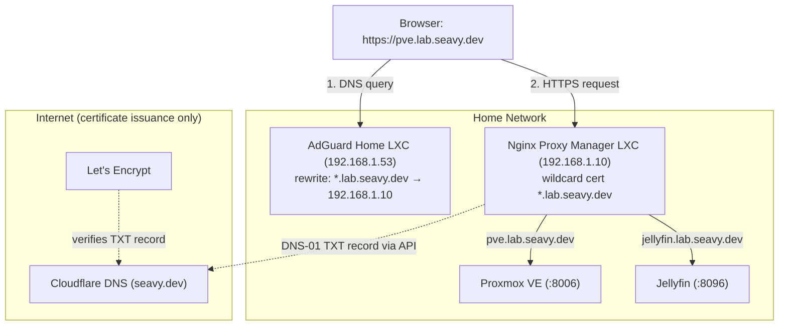

# Home Network Local DNS Guide (seavy.dev Edition)

Type `pve.lab.seavy.dev` instead of `https://192.168.1.5:8006` for every service on the home network. This guide uses AdGuard Home for local DNS and Nginx Proxy Manager as a reverse proxy. A wildcard Let's Encrypt certificate is issued through Cloudflare's DNS API, so every service gets a trusted HTTPS padlock and no ports are opened to the internet.

---

## Architecture Overview



> The IP addresses in this guide (`192.168.1.x`) are examples. Substitute your own network's addresses.

---

## 1. Why Not `.local`?

`.local` is reserved for **mDNS** (Bonjour/Avahi, RFC 6762). macOS, iOS, and most Linux systems send any `*.local` lookup to multicast instead of your DNS server. The result is inconsistent: names work on some devices, fail on others, or take several seconds to resolve.

| Suffix | Verdict |
|---|---|
| `.local` | ❌ Conflicts with mDNS |
| `home.arpa` | ✅ The official reserved name for home networks (RFC 8375), but you can't get trusted certificates for it |
| `.internal` / `.lan` | ⚠️ They resolve fine, but you can't get trusted certificates for them |
| **A subdomain of a domain you own** (`lab.seavy.dev`) | ✅ **Best option:** real, publicly trusted HTTPS certificates |

### Why a subdomain (`lab.`) instead of the bare domain?

Putting home services under `*.lab.seavy.dev` keeps `seavy.dev` and `www.seavy.dev` free for anything public later. A local wildcard on the bare domain (`*.seavy.dev`) would override any public subdomains for devices on your network.

---

## 2. Comparing Local DNS Options

| Option | Pros | Cons |
|---|---|---|
| **Router DNS** (UniFi, OPNsense, pfSense, OpenWrt) | Nothing new to run | Most ISP routers don't support it |
| **Pi-hole** | Popular, blocks ads | Wildcards need a manual dnsmasq config file |
| **AdGuard Home** ⭐ | Clean UI, **wildcard DNS rewrites** built in, encrypted upstreams | One more service to keep running |
| **Technitium DNS** | Full authoritative DNS server, good for learning | More than most home labs need |
| `/etc/hosts` | Zero setup | Edited per machine, doesn't work on phones |
| **Tailscale MagicDNS** | Works away from home | Only covers devices on your Tailscale network |

**This guide uses AdGuard Home** because of its wildcard rewrites: a single rule covers every current and future service.

---

## 3. Important: `.dev` Is HTTPS-Only

Every `.dev` domain is on the browser **HSTS preload list**. Chrome, Firefox, Safari, and Edge refuse to load any `.dev` site over plain `http://`. Valid TLS certificates are a requirement here, not an extra. The reverse proxy and wildcard certificate below handle this.

---

## 4. Create a Cloudflare API Token

Nginx Proxy Manager uses this token to create temporary TXT records that prove to Let's Encrypt you own the domain.

1. Cloudflare dashboard → **My Profile** → **API Tokens** → **Create Token**
2. Choose the **Edit zone DNS** template
3. Configure it:
   - **Permissions:** `Zone` → `DNS` → `Edit`
   - **Zone Resources:** `Include` → `Specific zone` → `seavy.dev`
4. Create the token and **copy it somewhere safe**. Cloudflare only shows it once.

> 🔒 Scoping the token to a single zone means a leaked token can only edit DNS for `seavy.dev`, not your whole Cloudflare account.

---

## 5. Install AdGuard Home (Proxmox LXC)

Run this from the Proxmox host shell (**Datacenter → your node → Shell**). It uses the community-maintained [Proxmox VE Helper-Scripts](https://community-scripts.github.io/ProxmoxVE/). Read the script before running it.

```bash
bash -c "$(curl -fsSL https://raw.githubusercontent.com/community-scripts/ProxmoxVE/main/ct/adguard.sh)"
```

- Choose **Advanced** settings and give the container a **static IP** (for example `192.168.1.53/24`). Clients will point at this address, so it must never change.
- Open `http://192.168.1.53:3000` to finish the setup wizard. Listen on all interfaces, port 53 for DNS.

### Recommended upstream DNS servers

**Settings → DNS settings → Upstream DNS servers:**

```text
https://dns.cloudflare.com/dns-query
https://dns.quad9.net/dns-query
```

Choose **Parallel requests** or **Load-balancing**.

---

## 6. Add the Wildcard DNS Rewrite

**Filters → DNS rewrites → Add DNS rewrite:**

| Domain | Answer |
|---|---|
| `*.lab.seavy.dev` | `192.168.1.10` (Nginx Proxy Manager IP) |
| `lab.seavy.dev` | `192.168.1.10` |

Every `*.lab.seavy.dev` name now resolves to the reverse proxy, which routes each request to the right service by hostname.

> 💡 **Why DNS alone isn't enough:** DNS maps a name to an IP address, never to a port. Proxmox is on `:8006` and Jellyfin is on `:8096`, so without a proxy you would still be typing ports. The proxy reads the requested hostname and forwards to the correct port.

---

## 7. Install Nginx Proxy Manager (Proxmox LXC)

From the Proxmox host shell:

```bash
bash -c "$(curl -fsSL https://raw.githubusercontent.com/community-scripts/ProxmoxVE/main/ct/nginxproxymanager.sh)"
```

- Give it a **static IP** (for example `192.168.1.10/24`).
- Open the admin UI at `http://192.168.1.10:81`. Check the helper script's output for the default login, then change it right away.

---

## 8. Issue the Wildcard Certificate

**SSL Certificates → Add SSL Certificate → Let's Encrypt:**

1. **Domain Names:** `*.lab.seavy.dev` and `lab.seavy.dev`
2. Turn on **Use a DNS Challenge**
3. **DNS Provider:** Cloudflare
4. **Credentials File Content:**
   ```ini
   dns_cloudflare_api_token = <your-token-here>
   ```
5. Agree to the Let's Encrypt terms and save. Issuance takes about 30 to 60 seconds.

Nginx Proxy Manager renews the certificate automatically before its 90-day expiry using the same token.

> 💡 **Why this works for private services:** the DNS-01 challenge only checks a TXT record in public DNS. Let's Encrypt never connects to your server, so a service that's only reachable on your home network still gets a publicly trusted certificate.

---

## 9. Add Proxy Hosts

**Hosts → Proxy Hosts → Add Proxy Host.** Repeat for each service.

### Proxmox VE

| Field | Value |
|---|---|
| Domain Names | `pve.lab.seavy.dev` |
| Scheme | `https` (Proxmox serves its own self-signed certificate) |
| Forward Hostname / IP | `192.168.1.5` (your Proxmox host) |
| Forward Port | `8006` |
| Websockets Support | ✅ **Required** for the noVNC/xterm.js console |
| Block Common Exploits | ✅ |

**SSL tab:** select the `*.lab.seavy.dev` certificate and turn on **Force SSL** and **HTTP/2 Support**.

### Example services

| Hostname | Scheme | Forward to |
|---|---|---|
| `pve.lab.seavy.dev` | https | `192.168.1.5:8006` |
| `jellyfin.lab.seavy.dev` | http | `192.168.1.20:8096` |
| `adguard.lab.seavy.dev` | http | `192.168.1.53:80` |
| `npm.lab.seavy.dev` | http | `192.168.1.10:81` |

Adding a new service later only takes a new proxy host here. DNS and certificates already cover it.

---

## 10. Point the Network at AdGuard

In your router's **DHCP settings**, set the **DNS server** handed out to clients to `192.168.1.53`. Devices pick it up the next time they renew their DHCP lease. Reconnecting to Wi-Fi forces a renewal.

**Router-specific locations:**
- **UniFi:** Settings → Networks → (your LAN) → DHCP Service Management → DNS Server
- **OPNsense:** Services → ISC DHCPv4 → LAN → DNS servers (or the Kea DHCP equivalent)
- **pfSense:** Services → DHCP Server → LAN → DNS servers
- **ISP routers:** look for "LAN DNS" or "DHCP DNS". If you can't change it, set DNS manually on each device or let AdGuard serve DHCP instead.

### Verify

```bash
# Should return 192.168.1.10
dig +short pve.lab.seavy.dev @192.168.1.53

# Check which DNS server your Mac is using
scutil --dns | grep nameserver | head -3
```

Then browse to `https://pve.lab.seavy.dev`. You should see the Proxmox login page with a valid padlock.

---

## 11. Gotchas & Resilience

- **Don't add `lab` records in Cloudflare's public DNS.** Only the temporary challenge TXT records go there. Your internal hostnames stay invisible to the public internet (split-horizon DNS).
- **DNS is a single point of failure.** If the Proxmox host is down, AdGuard is down too, and so is name resolution for the whole house. Options:
  - Run a **second AdGuard Home** on separate hardware (a Raspberry Pi works well) and hand out both IPs over DHCP. [adguardhome-sync](https://github.com/bakito/adguardhome-sync) keeps the two configs in sync.
  - Or set the router's secondary DNS to `1.1.1.1`. Be aware that some clients will pick the secondary at random and fail to resolve `lab` names.
- **Bookmark the raw IPs** (`https://192.168.1.5:8006`) as a fallback for when DNS or the proxy is broken.
- **iCloud Private Relay / browser "Secure DNS"** can bypass AdGuard. If a single device can't resolve `lab` names, check the Private Relay setting on Apple devices and Chrome's "Use secure DNS" setting.
- **Keep the containers' boot order sensible:** in Proxmox, set AdGuard and NPM to **Start at boot** with a low startup order number so DNS is up before other guests start.

---

## 12. Maintenance & Useful Commands

### Update the containers

The helper scripts add an `update` command inside each LXC:

```bash
# From the Proxmox host
pct enter <adguard-ctid>
update
```

### Check the certificate's expiry date

```bash
echo | openssl s_client -connect pve.lab.seavy.dev:443 -servername pve.lab.seavy.dev 2>/dev/null \
  | openssl x509 -noout -dates
```

### Clear the macOS DNS cache after changes

```bash
sudo dscacheutil -flushcache; sudo killall -HUP mDNSResponder
```
