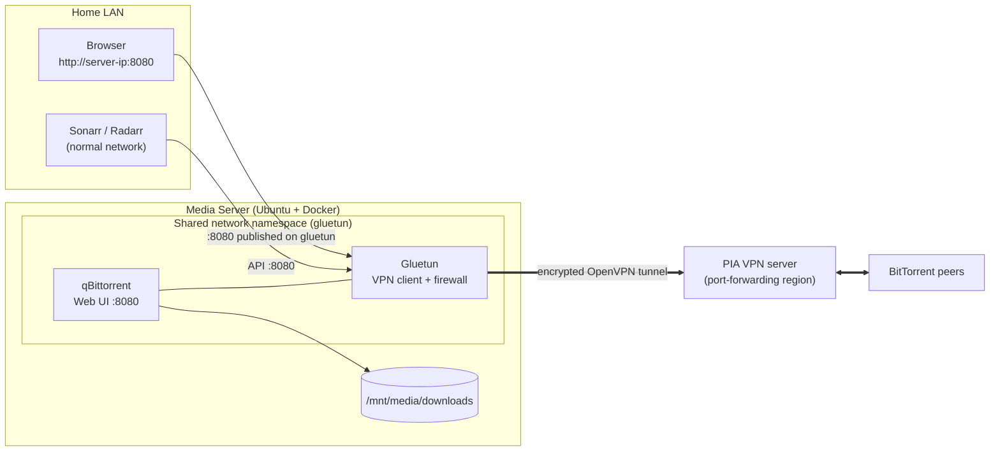
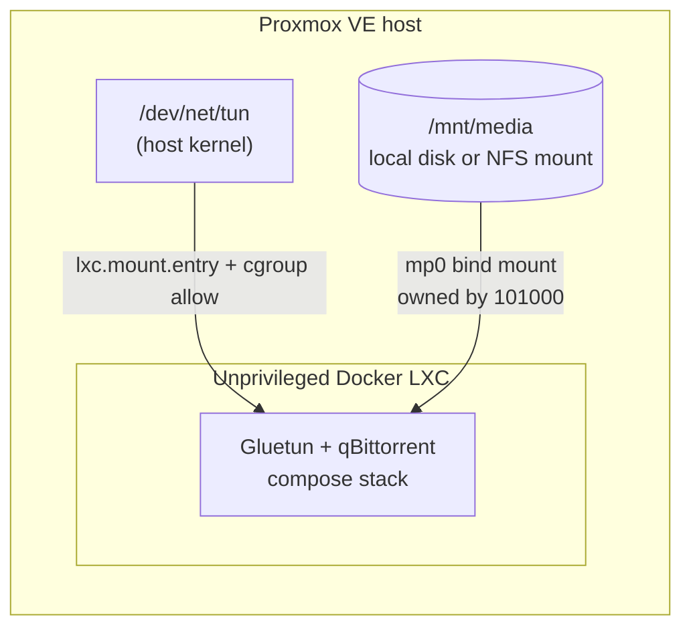
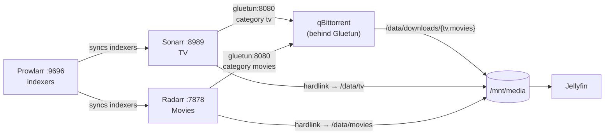

# Torrent Client Behind PIA VPN (qBittorrent + Gluetun Edition)

Run qBittorrent on the homelab with every packet forced through a Private Internet Access (PIA) VPN tunnel, a built-in kill switch, and automatic port forwarding. It is built as a companion to the [Home Media Server guide](home-media-server.md): same Ubuntu Server + Docker Compose host, same `/mnt/media` storage, ready for Sonarr and Radarr.

---

## Architecture Overview



**How it works:** qBittorrent has no network stack of its own. It uses `network_mode: "service:gluetun"`, so it shares Gluetun's network namespace. Gluetun's firewall only lets traffic out through the VPN tunnel. If the tunnel drops, qBittorrent loses internet access entirely instead of falling back to your real IP.

---

## 1. Choosing a Torrent Client

| Client | Best For | Pros | Considerations |
| :--- | :--- | :--- | :--- |
| **qBittorrent** *(Recommended)* | Most homelabs | Full-featured web UI and API, first-class Sonarr/Radarr/Prowlarr support, large community, well-maintained Docker images | None significant |
| **Transmission** | Minimal setups | Extremely lightweight | Fewer features, basic web UI |
| **Deluge** | Plugin users | Plugin system | Plugins often break between versions, smaller community |
| **rTorrent / ruTorrent** | Thousands of torrents | Scales to huge seeding libraries | Complex setup, overkill for most homes |

---

## 2. Why Gluetun and Port Forwarding

* **Kill switch by design**: Gluetun's built-in firewall blocks all traffic that isn't going through the tunnel. Nothing in the shared namespace can leak.
* **Startup ordering**: With a `service_healthy` dependency, qBittorrent doesn't start until the tunnel is up.
* **Port forwarding**: Without an open incoming port, you can't connect to peers who also have no open port. That means fewer peers, slower downloads and poor seeding. PIA gives you a forwarded port, and Gluetun can push it into qBittorrent automatically.

> [!WARNING]
> PIA does **not** support port forwarding on its US servers. Set `PORT_FORWARD_ONLY=true` and pick a nearby non-US region such as Toronto, Montreal or Vancouver.

> [!NOTE]
> Gluetun supports PIA natively over **OpenVPN**. PIA WireGuard needs a config file generated with a third-party tool and Gluetun's custom provider. OpenVPN is the simpler and better-supported path, and it is fast enough for most home connections.

---

## 3. Prerequisites

* Docker Engine and the Compose plugin installed (see [Home Media Server §6](home-media-server.md)), **or** a Proxmox VE host (see §4).
* Your **PIA username** (`p1234567` format, not your email) and password, both shown in the PIA Client Control Panel.
* Your user's UID/GID (`id -u` and `id -g`, usually `1000`).

---

## 4. Running on Proxmox VE (Docker LXC)

If your homelab runs on Proxmox, the lightest option is a single unprivileged **Docker LXC** that hosts this compose stack. Compared with a plain Docker host, it needs three extra things: access to the TUN device, nesting so Docker can run, and a bind mount for your media storage. If you're on a plain Ubuntu/Docker host, skip to §5.



### Where commands run

On Proxmox, you type commands in two different places. Each step from here on starts with a **📍 Run on** label saying which one.

| Place | How to open it | Prompt looks like | Used for |
| :--- | :--- | :--- | :--- |
| **Proxmox host shell** | Web UI (`https://<proxmox-ip>:8006`) → click your node → **Shell** | `root@pve:~#` | `pct` commands, `apt` updates for Proxmox itself, editing `/etc/pve/lxc/*.conf`, host storage |
| **Inside the LXC** | From the host shell run `pct enter 120` (`exit` to leave), or click the container → **Console** | `root@docker:~#` | Everything `docker`, and all of §5 onward |

**Rule of thumb:** `pct` or `/etc/pve/` → host. `docker` or `~/torrent` → LXC. If unsure, check the hostname in the prompt.

> [!NOTE]
> **LXC or VM?** A VM (Debian or Ubuntu Server with Docker) needs none of the TUN or ownership workarounds below, and Proxmox's own docs suggest a VM for Docker. The trade-off is more RAM and disk use. For one torrent stack, the LXC is fine.

### 4.1 Fix the Proxmox apt repositories

> 📍 **Run on:** Proxmox host shell (`root@pve`)

A fresh Proxmox install points `apt` at the **enterprise** repositories, which only work with a paid subscription. Without one, `apt update` fails with errors such as `401 Unauthorized` for `enterprise.proxmox.com`. Switch to the free **no-subscription** repository before creating containers.

**Easiest (any Proxmox version): the web UI**

1. Click **your node → Updates → Repositories**.
2. Select each row whose URL contains `enterprise.proxmox.com` (usually `pve-enterprise` and a `ceph` one) and click **Disable**.
3. Click **Add**, choose **No-Subscription**, then **Add**.
4. A yellow "not recommended for production use" warning is normal for a homelab.

**Or from the shell.** Check your version first:

```bash
pveversion
```

<details>
<summary><b>Proxmox VE 9.x</b> (Debian 13 "trixie", <code>.sources</code> files)</summary>

```bash
# Disable the enterprise repositories
sed -i 's/^Types:/Enabled: no\nTypes:/' \
  /etc/apt/sources.list.d/pve-enterprise.sources \
  /etc/apt/sources.list.d/ceph.sources

# Add the no-subscription repository
cat > /etc/apt/sources.list.d/pve-no-subscription.sources <<'EOF'
Types: deb
URIs: http://download.proxmox.com/debian/pve
Suites: trixie
Components: pve-no-subscription
Signed-By: /usr/share/keyrings/proxmox-archive-keyring.gpg
EOF
```

</details>

<details>
<summary><b>Proxmox VE 8.x</b> (Debian 12 "bookworm", <code>.list</code> files)</summary>

```bash
# Disable the enterprise repositories
sed -i 's/^deb/# deb/' \
  /etc/apt/sources.list.d/pve-enterprise.list \
  /etc/apt/sources.list.d/ceph.list

# Add the no-subscription repository
echo "deb http://download.proxmox.com/debian/pve bookworm pve-no-subscription" \
  > /etc/apt/sources.list.d/pve-no-subscription.list
```

</details>

**Then update:**

```bash
apt update
apt full-upgrade
```

> [!IMPORTANT]
> On Proxmox, always use `apt full-upgrade` (or **Updates → Upgrade** in the web UI), never plain `apt upgrade`. Proxmox updates sometimes need to add or remove packages, and `upgrade` can leave the system half-updated. Reboot if a new kernel was installed.

> [!TIP]
> If `apt update` shows something other than `401 Unauthorized`, check the troubleshooting table in §11. `NO_PUBKEY`, `does not have a Release file` and DNS errors have different causes.

### 4.2 Create the Docker LXC

> 📍 **Run on:** Proxmox host shell (`root@pve`)

From the Proxmox host shell (**Datacenter → your node → Shell**), using the community-maintained [Proxmox VE Helper-Scripts](https://community-scripts.github.io/ProxmoxVE/). Read the script before running it.

```bash
bash -c "$(curl -fsSL https://raw.githubusercontent.com/community-scripts/ProxmoxVE/main/ct/docker.sh)"
```

- Choose **Debian** and keep the container **unprivileged** (the default).
- About 2 cores, 2 GB RAM and 8 GB disk is plenty for the torrent stack alone. If you'll add Sonarr, Radarr and Prowlarr (§10), give it **20–32 GB**: their databases and poster artwork live on this disk. Downloads go to the bind mount, not the container disk. To check or grow it later, see §12.
- If the **Advanced** settings offer TUN/TAP, turn it on. §4.3 makes sure either way.
- Accept DHCP, then reserve the container's IP on the router like your other LXCs.
- Note the container ID. The examples below use `120`.

### 4.3 Pass through the TUN device

> 📍 **Run on:** Proxmox host shell (`root@pve`)

Gluetun creates its VPN interface through `/dev/net/tun`. An LXC shares the Proxmox host's kernel and isn't allowed to use that device unless you pass it in. Stop the container and edit its config **on the Proxmox host**:

```bash
pct stop 120
nano /etc/pve/lxc/120.conf
```

Add these lines (skip any the helper script already added):

```ini
features: keyctl=1,nesting=1
lxc.cgroup2.devices.allow: c 10:200 rwm
lxc.mount.entry: /dev/net/tun dev/net/tun none bind,create=file
```

* `nesting=1` and `keyctl=1` let Docker run inside an unprivileged container.
* `c 10:200` is the character device number for `/dev/net/tun`. The cgroup rule allows access, and the mount entry makes the device appear inside the container.

### 4.4 Bind-mount the download storage

> 📍 **Run on:** Proxmox host shell (`root@pve`)

In an unprivileged LXC, user 1000 inside the container is user **101000** on the host. Files on a bind mount must be owned by `101000` on the host so the container's `PUID=1000` can write to them.

> [!WARNING]
> **Make sure `/mnt/media` is a real disk, not just a folder.** `mkdir /mnt/media` only creates a directory on the Proxmox host's system disk, which is often under 100 GB. Downloads then fill the host's root filesystem, and a full root disk stops Proxmox from writing its config and logs and can keep VMs and containers from starting. Check first:
>
> ```bash
> findmnt /mnt/media
> ```
>
> If this prints nothing, `/mnt/media` is a plain folder. Mount a disk there (a second drive, or a volume as below) or use a NAS share before continuing.

**No second drive? Make a volume in `local-lvm`.** On a single-disk install, most of the SSD is in the `local-lvm` thin pool. Check how much is free and how much is already promised to VM and container disks:

```bash
lvs pve
```

Pick a size that keeps the **total of all disks in the pool** below the pool's size (the `data` row). Thin pools let you promise more than you have, and a pool that hits 100% can corrupt every disk on it. Then create, format and mount the volume (`240G` here):

```bash
lvcreate -V 240G -T pve/data -n media
mkfs.ext4 -m 0 -L media /dev/pve/media
mkdir -p /mnt/media
chattr +i /mnt/media          # the bare folder is read-only, so nothing can write to it unmounted
echo "/dev/pve/media /mnt/media ext4 defaults 0 2" >> /etc/fstab
systemctl daemon-reload
mount /mnt/media
findmnt /mnt/media            # should now show /dev/mapper/pve-media
```

`-m 0` skips ext4's 5% reserve for root, which a data-only disk doesn't need. The `chattr +i` safeguard makes the empty folder *underneath* the mount immutable: if the volume ever fails to mount, writes to `/mnt/media` fail with an error instead of filling the host's root disk. Don't add `nofail` to the fstab line. It lets the host boot without the volume, and containers could then start writing to the bare folder.

> [!TIP]
> **Already filled the root disk?** Stop the stack and the LXC (`pct shutdown 120`), create and mount the volume at a temporary path such as `/mnt/media-new`, copy with `rsync -aHAXS /mnt/media/ /mnt/media-new/`, and check it with `rsync -aHAXnc --itemize-changes --exclude=lost+found /mnt/media/ /mnt/media-new/` (no output means identical). Then delete the old files, unmount the temporary path, and mount at `/mnt/media` as above. The LXC must be stopped while you do this: a running container keeps seeing the old folder until it restarts.

**The media disk is on the Proxmox host** (for example `/mnt/media`, mounted as above):

```bash
pct set 120 -mp0 /mnt/media,mp=/mnt/media
mkdir -p /mnt/media/downloads
chown -R 101000:101000 /mnt/media/downloads
```

**The media is on another machine** (a separate Jellyfin box or a NAS): unprivileged LXCs can't mount NFS or SMB shares themselves. Mount the share on the Proxmox host first (for example **Datacenter → Storage → Add → NFS**, which mounts at `/mnt/pve/<storage-id>`), then bind-mount it:

```bash
pct set 120 -mp0 /mnt/pve/media,mp=/mnt/media
```

> [!TIP]
> On NFS, the share's export settings decide ownership. Map writes to a UID the container can use: `all_squash,anonuid=101000,anongid=101000` on the NAS export is the simplest choice.

### 4.5 Start and verify

> 📍 **Run on:** Proxmox host shell (`root@pve`)

```bash
pct start 120
pct enter 120
```

> 📍 **Run on:** inside the LXC. `pct enter` just put you there, and the prompt now shows the container's hostname.

```bash
ls -l /dev/net/tun        # should show a character device: crw-rw-rw- ... 10, 200
docker --version
touch /mnt/media/downloads/.write-test && rm /mnt/media/downloads/.write-test && echo "storage writable"
```

All three checks should pass. **Stay in the LXC** and continue with §5: the directory layout, `.env` and compose file are the same. The web UI is at `http://<lxc-ip>:8080`.

---

## 5. Directory Layout

> 📍 **Run on:** your Docker host. On Proxmox, that's **inside the LXC** (`pct enter 120`).

Put downloads on the **same filesystem** as your media library. Then Sonarr and Radarr can *hardlink* finished downloads into `/mnt/media/movies` and `/mnt/media/tv`: they finish instantly, use no extra disk space, and seeding continues.

```bash
sudo mkdir -p /mnt/media/downloads
sudo chown -R 1000:1000 /mnt/media/downloads
mkdir -p ~/torrent && cd ~/torrent
```

> [!TIP]
> **On Proxmox:** you're `root` inside the LXC and `sudo` usually isn't installed, so leave it off. You already created and `chown`ed `/mnt/media/downloads` from the host in §4.4, so only the last line is needed.

---

## 6. Store PIA Credentials

> 📍 **Run on:** your Docker host. On Proxmox, that's **inside the LXC** (`pct enter 120`).

Create `~/torrent/.env` so your credentials stay out of the compose file:

```bash
nano .env
```

```ini
PIA_USER=p1234567
PIA_PASS=your-pia-password
```

Lock down the permissions:

```bash
chmod 600 .env
```

> [!CAUTION]
> Never commit `.env` to Git. If `~/torrent` is a repository, add `.env` to `.gitignore`.

---

## 7. Docker Compose Stack

> 📍 **Run on:** your Docker host. On Proxmox, that's **inside the LXC** (`pct enter 120`).

Create `docker-compose.yml`:

```bash
nano docker-compose.yml
```

```yaml
services:
  gluetun:
    image: qmcgaw/gluetun:latest
    container_name: gluetun
    cap_add:
      - NET_ADMIN
    devices:
      - /dev/net/tun:/dev/net/tun
    ports:
      - 8080:8080            # qBittorrent Web UI (published here, NOT on qbittorrent)
    environment:
      - VPN_SERVICE_PROVIDER=private internet access
      - OPENVPN_USER=${PIA_USER}
      - OPENVPN_PASSWORD=${PIA_PASS}
      - SERVER_REGIONS=CA Toronto,CA Montreal
      - PORT_FORWARD_ONLY=true
      - VPN_PORT_FORWARDING=on
      # Push PIA's forwarded port + VPN interface into qBittorrent whenever it changes
      - VPN_PORT_FORWARDING_UP_COMMAND=/bin/sh -c 'wget -O- -nv --retry-connrefused --post-data "json={\"listen_port\":{{PORT}},\"current_network_interface\":\"{{VPN_INTERFACE}}\",\"random_port\":false,\"upnp\":false}" http://127.0.0.1:8080/api/v2/app/setPreferences'
      # Reset on teardown so qBittorrent re-binds correctly after a reconnect
      - VPN_PORT_FORWARDING_DOWN_COMMAND=/bin/sh -c 'wget -O- -nv --retry-connrefused --post-data "json={\"listen_port\":0,\"current_network_interface\":\"lo\"}" http://127.0.0.1:8080/api/v2/app/setPreferences'
      # Refresh Gluetun's PIA server list every 20 days (stale data breaks port forwarding)
      - UPDATER_PERIOD=480h
      - TZ=America/New_York
    volumes:
      - ./gluetun:/gluetun
    restart: unless-stopped

  qbittorrent:
    image: lscr.io/linuxserver/qbittorrent:latest
    container_name: qbittorrent
    network_mode: "service:gluetun"   # All traffic goes through the VPN
    depends_on:
      gluetun:
        condition: service_healthy
    environment:
      - PUID=1000
      - PGID=1000
      - TZ=America/New_York
      - WEBUI_PORT=8080
    volumes:
      - ./qbittorrent:/config
      - /mnt/media/downloads:/data/downloads
    restart: unless-stopped
```

**Key details:**

* **Ports go on `gluetun`**: A container using another container's network namespace can't publish its own ports. Every port qBittorrent needs is published on Gluetun.
* **`{{PORT}}` and `{{VPN_INTERFACE}}`**: Gluetun fills these in at runtime. The UP command sets the listening port and also binds qBittorrent to the VPN interface (`tun0`), a second layer of leak protection.
* **The DOWN command** works around a qBittorrent bug: without it, port forwarding isn't re-established after a VPN reconnect.
* **`UPDATER_PERIOD`** makes Gluetun refresh its PIA server list over the tunnel. PIA moves server names between IPs, and stale data breaks port forwarding with a certificate error (see §11). Don't set it below `360h`: frequent updates can get rate-limited by the provider.
* **Region names** must match Gluetun's PIA server list exactly (for example `CA Toronto`). If Gluetun reports an invalid region at startup, its error message lists the valid names.

Start the stack:

```bash
docker compose up -d
```

Watch the VPN connect:

```bash
docker logs -f gluetun
```

---

## 8. First-Time qBittorrent Configuration

> 📍 **Run on:** step 1 and the restart in step 4 run on your Docker host (inside the LXC on Proxmox). Steps 2–3 are in your web browser.

1. Get the temporary admin password that the linuxserver image prints on first start:
   ```bash
   docker logs qbittorrent 2>&1 | grep -i password
   ```
2. Open `http://<server-ip>:8080` and log in as `admin`.
3. Go to **Tools → Options**:
   * **Web UI**:
     * Set a new username and password.
     * Tick **Bypass authentication for clients on localhost**. This is **required**: Gluetun calls the qBittorrent API from `127.0.0.1` to update the forwarded port.
   * **Downloads**:

     | Setting | Value |
     | :--- | :--- |
     | **Default Torrent Management Mode** | **Automatic** |
     | **When Category Save Path changed** | **Relocate torrent** |
     | **Default Save Path** | **`/data/downloads`** |
     | **Keep incomplete torrents in** | Leave unticked. If you do tick it, use `/data/downloads/incomplete`. |

     **Leave the category save paths empty.** Sonarr and Radarr create the `tv` and `movies` categories the first time they send a download (§10). A category with an empty save path saves to a subfolder of the default, so downloads go to `/data/downloads/tv` and `/data/downloads/movies` without any extra setup.
   * **Connection**:
     * Leave UPnP / NAT-PMP **off**. The port comes from PIA, not your router.
   * **Advanced → Network interface**: Gluetun sets this to `tun0` automatically. Check that it isn't `Any interface`.
4. Click **Save**, then recreate the stack so Gluetun's UP command runs again with the new settings:
   ```bash
   cd ~/torrent && docker compose down && docker compose up -d
   ```
   Don't use `docker restart gluetun` here. qBittorrent shares Gluetun's network namespace, and restarting only Gluetun leaves qBittorrent cut off (see §11).

> [!NOTE]
> **Until this step is done, Gluetun's logs show port forwarding errors. That's expected.** On a first start:
> * A run of `up command: failed: Connection refused` lines is **normal**. qBittorrent waits until Gluetun is healthy, so Gluetun retries until qBittorrent's Web UI is listening.
> * `ERROR [port forwarding] up command: ... URL:http://127.0.0.1:8080/api/v2/app/setPreferences [0/0] -> "-" [4]` is **success**, even though it says `ERROR`. Gluetun labels everything the UP command prints as an error, and `wget -nv` prints this status line when a request succeeds. `[0/0] -> "-"` is qBittorrent's empty "OK" response, and the final `[N]` is the attempt number.
> * `up command: ... ERROR 403: Forbidden` followed by `exit status 8` means qBittorrent rejected the request because **Bypass authentication for clients on localhost** isn't ticked yet. Gluetun gives up after that and doesn't retry until the VPN reconnects, which is why step 4 recreates the stack.
>
> If you can't restart right away, copy the port from `port forwarded is NNNNN` into **Connection → Listening port** by hand. Gluetun keeps it in sync on later reconnects.

> [!TIP]
> "Bypass authentication for clients on localhost" applies only to requests from inside the shared namespace. Requests from your LAN still need the password.

> [!WARNING]
> **Don't keep the linuxserver default of `/downloads`.** The compose file only mounts `/data/downloads`. Anything saved to `/downloads` stays inside the container: you can't see it on `/mnt/media`, Sonarr and Radarr can't import it, and it's lost when the container is recreated. Keep the incomplete folder under `/data/downloads` too. qBittorrent moves finished torrents out of it, and on the same mount that move is instant instead of a full copy.

To check that the save path really points at your storage:

> 📍 **Run on:** your Docker host (inside the LXC on Proxmox).

```bash
docker exec qbittorrent ls -la /data/downloads
```

Any file listed here should also show up on the host under `/mnt/media/downloads`.

---

## 9. Verification

> 📍 **Run on:** your Docker host. On Proxmox, that's **inside the LXC** (`pct enter 120`). The last check, the torrent IP leak test, is in the qBittorrent web UI.

### Confirm the public IP is PIA's, not yours
```bash
docker exec qbittorrent curl -s ifconfig.io   # should be a PIA IP
curl -s ifconfig.io                           # your real home IP, for comparison (runs outside the VPN)
```

### Confirm port forwarding
```bash
docker logs gluetun 2>&1 | grep -i "port forward"
```
The log should show `port forwarded is NNNNN`, then a `setPreferences [0/0] -> "-"` line (labeled `ERROR`, but that's the success message), with **no** `exit status` line after it, and qBittorrent's **Tools → Options → Connection → Listening port** should match that number. A few `Connection refused` retries right after startup are fine (see the note in §8).

### Test the kill switch
```bash
docker stop gluetun
docker exec qbittorrent curl -s --max-time 5 ifconfig.io || echo "No connectivity - kill switch working"
docker start gluetun
```

### Torrent IP leak test
Add the magnet link from [ipleak.net](https://ipleak.net) ("Torrent Address detection"). The IP it reports must be the PIA IP.

---

## 10. Sonarr, Radarr & Prowlarr

Add the *arr apps to the **same compose file** (on Proxmox, the same Docker LXC). The storage mount and ownership are already done, and the apps can reach each other by container name.



* **Prowlarr** keeps your indexers (torrent sites) in one place and syncs them to Sonarr and Radarr.
* **Sonarr** (TV) and **Radarr** (movies) send downloads to qBittorrent, then import the finished files into your library.
* **Don't put them behind Gluetun.** Only torrent traffic needs the VPN. They reach qBittorrent at `gluetun:8080` over the compose network.

> [!IMPORTANT]
> **Paths are what matter most.** qBittorrent saves to `/data/downloads/...`, and Sonarr and Radarr must see that **same path**. They also need the downloads and the library on **one mount**, because hardlinks can't cross mount points inside a container. Mounting all of `/mnt/media` at `/data` covers both. A hardlinked import is instant, uses no extra space, and lets the torrent keep seeding.

### 10.1 Create the library folders

> 📍 **Run on:** Proxmox host shell (`root@pve`). On a plain Docker host, run it there with `sudo` and `chown 1000:1000` instead.

```bash
mkdir -p /mnt/media/tv /mnt/media/movies
chown -R 101000:101000 /mnt/media/tv /mnt/media/movies
```

If your media is on another machine over NFS (§4.4), create these folders there instead.

### 10.2 Add the apps to the compose file

> 📍 **Run on:** your Docker host. On Proxmox, that's **inside the LXC** (`pct enter 120`).

```bash
cd ~/torrent && nano docker-compose.yml
```

Add these under `services:`, after `qbittorrent`, with the same indentation:

```yaml
  prowlarr:
    image: lscr.io/linuxserver/prowlarr:latest
    container_name: prowlarr
    environment:
      - PUID=1000
      - PGID=1000
      - TZ=America/New_York
    volumes:
      - ./prowlarr:/config
    ports:
      - 9696:9696
    restart: unless-stopped

  sonarr:
    image: lscr.io/linuxserver/sonarr:latest
    container_name: sonarr
    environment:
      - PUID=1000
      - PGID=1000
      - TZ=America/New_York
    volumes:
      - ./sonarr:/config
      - /mnt/media:/data        # sees /data/downloads AND /data/tv
    ports:
      - 8989:8989
    restart: unless-stopped

  radarr:
    image: lscr.io/linuxserver/radarr:latest
    container_name: radarr
    environment:
      - PUID=1000
      - PGID=1000
      - TZ=America/New_York
    volumes:
      - ./radarr:/config
      - /mnt/media:/data        # sees /data/downloads AND /data/movies
    ports:
      - 7878:7878
    restart: unless-stopped
```

Start the new containers. The VPN stack keeps running:

```bash
docker compose up -d
```

| Container | Path inside | Host path |
| :--- | :--- | :--- |
| qBittorrent | `/data/downloads` | `/mnt/media/downloads` |
| Sonarr / Radarr | `/data` (includes `/data/downloads`, `/data/tv`, `/data/movies`) | `/mnt/media` |

`/data/downloads/tv/...` means the same thing in all three containers, so no remote path mapping is needed.

### 10.3 Configure Sonarr

> 📍 **Run on:** Sonarr web UI at `http://<server-ip>:8989`. On first launch it asks you to create a login.

1. **Settings → Media Management**:
   * **Add Root Folder**: `/data/tv`.
   * Click **Show Advanced** and check that **Use Hardlinks instead of Copy** is ticked (the default).
2. **Settings → Download Clients → + → qBittorrent**:

   | Field | Value |
   | :--- | :--- |
   | Host | `gluetun` |
   | Port | `8080` |
   | Username / Password | Your qBittorrent Web UI login |
   | Category | `tv` |

   Click **Test**, then **Save**.
3. **Settings → General**: copy the **API Key** for Prowlarr.

> [!NOTE]
> The **Bypass authentication for clients on localhost** setting from §8 doesn't apply here. Sonarr and Radarr connect from other containers, so they always need the qBittorrent username and password.

### 10.4 Configure Radarr

> 📍 **Run on:** Radarr web UI at `http://<server-ip>:7878`.

Same steps as Sonarr, with two differences:

* Root folder **`/data/movies`**
* Download client category **`movies`**

Copy Radarr's **API Key** too.

### 10.5 Configure Prowlarr

> 📍 **Run on:** Prowlarr web UI at `http://<server-ip>:9696`.

1. **Settings → Apps → + → Sonarr**:
   * **Prowlarr Server**: `http://prowlarr:9696`
   * **Sonarr Server**: `http://sonarr:8989`
   * **API Key**: Sonarr's key
   * **Test**, then **Save**
2. Repeat for **Radarr**, with Radarr Server `http://radarr:7878` and Radarr's key.

Now add indexers (§10.6). Once the apps are connected, Prowlarr pushes every indexer you add to both of them.

### 10.6 Add indexers (and FlareSolverr if needed)

> 📍 **Run on:** Prowlarr web UI at `http://<server-ip>:9696`.

1. Go to **Indexers → Add Indexer**.
2. Narrow the list with the filters at the top: set **Protocol** to *torrent*, and **Privacy** to *public*, *semi-private* or *private*.
3. Click an indexer to open its form:
   * **Public** indexers usually need nothing filled in.
   * **Private** trackers ask for your login, an **API key** or a **cookie**. These come from your account page on the tracker's site.
4. Click **Test**, then **Save**.
5. Prowlarr sends each saved indexer to Sonarr and Radarr automatically, using the **Apps** from §10.5. Confirm in Sonarr and Radarr under **Settings → Indexers**. If they don't appear, click **Sync App Indexers** in Prowlarr's **Indexers** toolbar.

To check that an indexer works, go to **Search** in Prowlarr, search for something, and see whether results come back.

#### Do you need FlareSolverr?

**Only if an indexer fails because of Cloudflare.** Some public sites put a "checking your browser" page in front of the site. Prowlarr can't get past it, so **Test** fails with an error that mentions **Cloudflare** or **"blocked by CloudFlare Protection"**. FlareSolverr runs a headless browser that solves that check for Prowlarr.

Most private trackers and many public indexers don't use that check. Add your indexers first, and set up FlareSolverr only if one of them hits this error.

> 📍 **Run on:** your Docker host. On Proxmox, that's **inside the LXC** (`pct enter 120`).

Add this to `docker-compose.yml` under `services:`:

```yaml
  flaresolverr:
    image: ghcr.io/flaresolverr/flaresolverr:latest
    container_name: flaresolverr
    environment:
      - LOG_LEVEL=info
      - TZ=America/New_York
    ports:
      - 8191:8191
    restart: unless-stopped
```

```bash
cd ~/torrent && docker compose up -d
```

> 📍 **Run on:** Prowlarr web UI.

1. Go to **Settings → Indexers → + → FlareSolverr**.
   * **Tags:** `flaresolverr`
   * **Host:** `http://flaresolverr:8191/`
   * **Test**, then **Save**.
2. Open the indexer that failed and add the **`flaresolverr`** tag to it. Only indexers with that tag go through FlareSolverr. The rest keep connecting directly, which is faster.

> [!NOTE]
> **Prowlarr uses tags to route traffic.** A proxy applies only to indexers that share its tag. That lets you send just the Cloudflare-protected sites through FlareSolverr, which takes a few seconds per request because it runs a real Chromium.

> [!TIP]
> **Indexer searches don't go through the VPN.** Prowlarr is outside Gluetun, so indexer sites see your home IP. They only see searches and `.torrent`/magnet downloads, never torrent traffic, which stays inside the tunnel. If you'd rather hide that too, put Prowlarr behind Gluetun the same way as qBittorrent: `network_mode: "service:gluetun"`, publish `9696:9696` on the `gluetun` service instead, and use `http://gluetun:9696` as the Prowlarr Server address in §10.5.

> [!WARNING]
> **FlareSolverr works sometimes and fails at other times.** Cloudflare changes its checks regularly, so an indexer that worked through FlareSolverr can start failing again. If that happens, update the image with `docker compose pull flaresolverr && docker compose up -d`.

### 10.7 End-to-end test

1. In Sonarr, click **Series → Add New**, pick a show, set the root folder to `/data/tv`, and search for one episode.
2. In qBittorrent, the download should appear with category **tv**, saving to `/data/downloads/tv`.
3. When it finishes, Sonarr imports it into `/data/tv/<Show>/...`. Confirm it was hardlinked, not copied:

   > 📍 **Run on:** your Docker host (inside the LXC on Proxmox).

   ```bash
   docker exec sonarr stat -c '%h %n' /data/tv/*/*/* | head
   ```

   A **2** at the start of a line means the file exists in two places but takes up the space of one.
4. Add the library to Jellyfin. With the [Home Media Server guide's](home-media-server.md) mounts, that's `/media/tv` and `/media/movies`.

> [!TIP]
> **Separate LXCs instead?** The community helper scripts have `sonarr.sh`, `radarr.sh` and `prowlarr.sh`. Each one needs its own `mp0` bind mount (§4.4) at the **same** `/data` path, its own `101000` ownership, and the Docker LXC's IP instead of `gluetun` as the qBittorrent host. It works, but there's more to set up than one compose file.

> [!TIP]
> **Requests for the household:** add **Jellyseerr** (`fallenbagel/jellyseerr`, port 5055) the same way. It connects to Jellyfin, Sonarr and Radarr, and gives everyone one page to request shows and movies.

---

## 11. Troubleshooting

| Symptom | Likely Cause | Fix |
| :--- | :--- | :--- |
| `AUTH_FAILED` in Gluetun logs | Wrong credentials | Use the `p1234567` username, not your email. Check `.env` for stray quotes or spaces. |
| Gluetun reports no servers for region | Region name typo or region lacks port forwarding | Use the exact name Gluetun lists, and pick a non-US region. |
| Web UI unreachable | Port published on the wrong container | `8080:8080` must be under `gluetun`, not `qbittorrent`. |
| `up command: ... ERROR 403: Forbidden` / `exit status 8` | qBittorrent rejected Gluetun's unauthenticated API call | Tick **Bypass authentication for clients on localhost** (§8), then `docker compose down && docker compose up -d`. |
| `up command: failed: Connection refused` that never stops | qBittorrent's Web UI isn't on port 8080, or qBittorrent isn't running | Check `WEBUI_PORT=8080` and `docker logs qbittorrent`. A handful of these at startup is normal. |
| Listening port never updates | Localhost bypass not ticked, or Web UI not on 8080 | Enable **Bypass authentication for clients on localhost**, then `docker compose down && docker compose up -d`. |
| Port stops working after a reconnect | Missing DOWN command | Add `VPN_PORT_FORWARDING_DOWN_COMMAND` as shown in §7. |
| `port forwarding ... API IP address not found` with `x509: certificate is valid for Server-XXXX-15a, not Server-XXXX-10a` | Gluetun's built-in PIA server list is out of date: that IP now belongs to a different PIA server | Refresh the server list (see **Port forwarding certificate error** below). The VPN itself still works, only port forwarding fails. |
| `docker compose up` → `failed to resolve reference ... lookup lscr.io on 192.168.x.1:53 ... i/o timeout` | The LXC's DNS (copied from the host, usually your router) is dropping queries | Run `pct set 120 --nameserver "1.1.1.1 9.9.9.9"` on the Proxmox host, then `pct reboot 120` (or **CT → DNS** in the web UI). For a quick fix, run `echo "nameserver 1.1.1.1" > /etc/resolv.conf` inside the LXC. Proxmox resets that file when the LXC restarts. |
| `apt update` → `401 Unauthorized` for `enterprise.proxmox.com` | Enterprise repository enabled without a subscription | Switch to the no-subscription repository (§4.1). |
| Sonarr/Radarr **Test** fails for qBittorrent | Wrong host or missing credentials | Host `gluetun`, port `8080`, and the qBittorrent Web UI username/password. The localhost bypass doesn't cover other containers. |
| Import fails: `path does not exist` / `not a valid path` | qBittorrent's reported path isn't visible inside Sonarr/Radarr | Mount `/mnt/media:/data` in Sonarr/Radarr so `/data/downloads` matches qBittorrent (§10.2). |
| Imports are copies (`stat` shows `1`), disk use doubles | Downloads and library on different mounts or filesystems | Use the single `/mnt/media:/data` mount, and keep downloads and library on the same disk or NFS export. |
| Prowlarr indexer **Test** fails: `blocked by CloudFlare Protection` | The site sits behind a Cloudflare browser check | Add FlareSolverr and tag the indexer `flaresolverr` (§10.6). If it already has the tag, `docker compose pull flaresolverr`. |
| Indexers added in Prowlarr don't show up in Sonarr/Radarr | The app connection in Prowlarr is missing or failing | Check **Settings → Apps** in Prowlarr (§10.5), then click **Sync App Indexers**. |
| Downloads finish but nothing appears in `/mnt/media/downloads` | qBittorrent is saving to an unmounted path (the image default `/downloads`) | Set **Default Save Path** to `/data/downloads` and **Default Torrent Management Mode** to **Automatic** (§8). |
| Proxmox host `df -h /` at 100%; host or containers misbehaving | `/mnt/media` is a plain folder on the host's root disk, so downloads filled it | Give `/mnt/media` its own disk or volume and move the files there (§4.4). |
| `no space left on device` from Docker, or apps crashing / databases corrupt | The LXC's root disk is full | Check with `df -h /` inside the LXC, then `pct resize 120 rootfs +16G` on the host (§12, **Check storage**). |
| Downloads stall or Sonarr/Radarr stop grabbing; `df -h /mnt/media` near 100% | Media storage is full | Free up or add space on the host. Set **Minimum Free Space** in Sonarr/Radarr (§12). |
| Sonarr/Radarr `Access denied` writing to `/data/tv` or `/data/movies` | Host folder ownership | On the Proxmox host, `chown -R 101000:101000` the library folders (§10.1). |
| qBittorrent shows "firewalled" | No forwarded port | Check the Gluetun logs for port forwarding, and confirm `VPN_PORT_FORWARDING=on`. |
| `cannot create TUN device` / `operation not permitted` (Proxmox) | TUN not passed into the LXC | In the **Proxmox host shell**, add the §4.3 lines to `/etc/pve/lxc/<id>.conf`, then `pct stop`/`pct start`. |
| `Permission denied` writing downloads (Proxmox) | Host-side ownership doesn't match the UID mapping | In the **Proxmox host shell** (not the LXC), `chown -R 101000:101000` the download folder (§4.4). |
| Slow speeds | Distant region or CPU-bound OpenVPN | Try a closer port-forwarding region. Check `htop` during downloads. |

### Port forwarding certificate error

> 📍 **Run on:** your Docker host. On Proxmox, that's **inside the LXC** (`pct enter 120`).

The symptom in `docker logs gluetun` is that the tunnel comes up and `[ip getter]` shows a PIA IP, but then:

```text
ERROR [port forwarding] ... API IP address not found: trying IP 10.x.0.1:
Get "https://10.x.0.1:19999/ping": tls: failed to verify certificate:
x509: certificate is valid for Server-10955-15a, not Server-10955-10a
```

Gluetun checks PIA's port-forwarding API against the server name it *expects* for that IP, taken from its built-in server list. PIA has since moved a different server onto that IP, so the names don't match and Gluetun refuses the connection. That's the correct thing for it to do: it is refusing a certificate it can't verify.

**Fix: refresh the server list and recreate the stack.**

```bash
cd ~/torrent
docker compose down
docker run --rm -v ./gluetun:/gluetun qmcgaw/gluetun update -providers "private internet access"
docker compose up -d
docker logs -f gluetun    # look for a "[port forwarding]" line with a port number
```

The update writes fresh data to `./gluetun/servers/`, which Gluetun uses on its next start. With `UPDATER_PERIOD=480h` in the compose file (§7), it keeps itself current after that.

> [!NOTE]
> The one-off `update` container runs **outside** the VPN. It resolves PIA server hostnames through public DNS-over-HTTPS (Cloudflare/Google) from your real IP. That reveals that you use PIA, but nothing about your torrents. The periodic `UPDATER_PERIOD` updates run through the tunnel.

> [!TIP]
> Use `docker compose down` / `up -d`, not just `docker restart gluetun`. qBittorrent shares Gluetun's network namespace, and if only Gluetun restarts, qBittorrent keeps a reference to the old, dead namespace and loses connectivity.

**If it still fails after the refresh**, pin a server whose name Gluetun has right. Choose one from the refreshed list:

```bash
grep -o '"server_name": *"[^"]*"' gluetun/servers/*.json | head
```

Then set `SERVER_NAMES=<name>` in the compose file.

---

## 12. Maintenance

> 📍 **Run on:** your Docker host. On Proxmox, that's **inside the LXC** (`pct enter 120`).

### Update both containers
```bash
cd ~/torrent
docker compose pull
docker compose up -d
```

### Check which IP and port are in use
```bash
docker exec qbittorrent curl -s ifconfig.io
docker logs gluetun 2>&1 | grep -i "port forward" | tail -1
```

### Clean up old images
```bash
docker image prune
```

### Check storage

Two separate places need enough space:

| What | Where it lives | Typical size |
| :--- | :--- | :--- |
| **Media and downloads** | Host storage at `/mnt/media`, bind-mounted into the LXC | As much as you can give it |
| **Docker images and app configs** (Gluetun, qBittorrent, and the Sonarr/Radarr/Prowlarr databases and artwork) | The LXC's own root disk (`rootfs`) | 20–32 GB with the §10 apps |

The bind mount isn't limited by the LXC's disk size. If `/mnt/media` is low on space, it's the **host's** storage that's full.

**1. Media storage**

> 📍 **Run on:** Proxmox host shell (`root@pve`)

```bash
df -h /mnt/media
```

The **Filesystem** column should be its own disk or share, not `/dev/mapper/pve-root`. If it shows `pve-root`, `/mnt/media` is a plain folder on the host's system disk: fix that first (§4.4). Look at **Avail**. This is the space shared by downloads and your library. With hardlinks (§10), an imported file only takes up space once, even while it keeps seeding. If `/mnt/media` is on ZFS, use this instead, because `df` can be misleading on ZFS:

```bash
zfs list -o name,used,avail,mountpoint
```

**2. The LXC's root disk**

> 📍 **Run on:** Proxmox host shell

```bash
pct config 120 | grep rootfs
```

This shows the disk size, for example `size=8G`. Then check how much of it is used, and what Docker and the app configs are using:

> 📍 **Run on:** inside the LXC

```bash
df -h /
docker system df
du -sh ~/torrent/*/
```

If **Use%** on `/` is over about 70%, grow the disk. This works while the LXC is running:

> 📍 **Run on:** Proxmox host shell

```bash
pct resize 120 rootfs +16G
```

You can do the same in the web UI: **CT 120 → Resources → Root Disk → Volume Action → Resize**. Proxmox can only make disks bigger, not smaller.

**3. The Proxmox storage pool**

> 📍 **Run on:** Proxmox host shell

```bash
pvesm status
lvs
```

If the LXC disk is on `local-lvm`, look at **Data%** for the `data` thin pool in the `lvs` output. Keep it under about 80%.

> [!WARNING]
> **Thin pools let you give out more space than you actually have.** A thin pool that reaches 100% can corrupt every VM and container on it. Check `lvs` before growing disks.

**4. Leave some free space as a buffer**

> 📍 **Run on:** Sonarr and Radarr web UIs

In **Settings → Media Management → Show Advanced → Minimum Free Space**, raise the default of 100 MB to something like **10000** MB. They will stop grabbing new downloads before the disk fills up.

> [!TIP]
> **What usually fills the root disk:** Sonarr's and Radarr's `MediaCover` folders store posters and fanart for every show and movie, and in a big library they reach several GB. Old Docker images add up too: every `docker compose pull` leaves the previous image behind, which is what `docker image prune` (above) cleans up.
