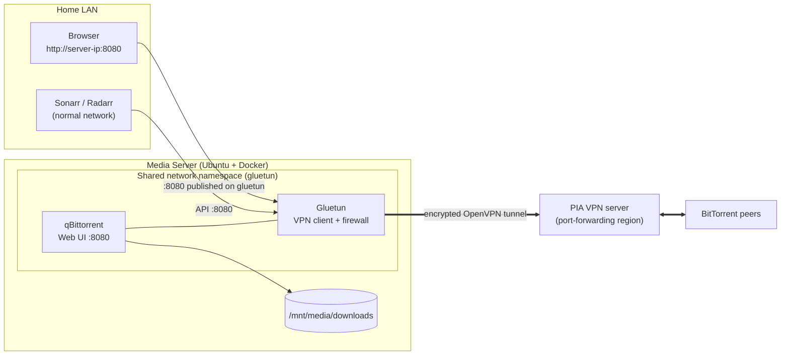
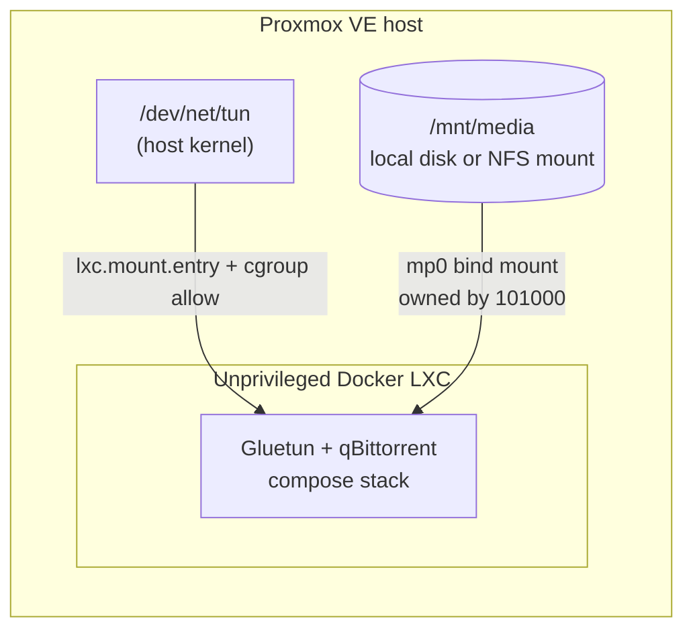

# Torrent Client Behind PIA VPN (qBittorrent + Gluetun Edition)

Run qBittorrent on the homelab with every packet forced through a Private Internet Access (PIA) VPN tunnel, a built-in kill switch, and automatic port forwarding. It is built as a companion to the [Home Media Server guide](home-media-server.md): same Ubuntu Server + Docker Compose host, same `/mnt/media` storage, ready for Sonarr and Radarr.

---

## Architecture Overview



**How it works:** qBittorrent has no network stack of its own. It uses `network_mode: "service:gluetun"`, so it shares Gluetun's network namespace. Gluetun's firewall only lets traffic out through the VPN tunnel. If the tunnel drops, qBittorrent loses internet access entirely instead of falling back to your real IP.

---

## 1. Choosing a Torrent Client

| Client | Best For | Pros | Considerations |
| :--- | :--- | :--- | :--- |
| **qBittorrent** *(Recommended)* | Most homelabs | Full-featured web UI and API, first-class Sonarr/Radarr/Prowlarr support, large community, well-maintained Docker images | None significant |
| **Transmission** | Minimal setups | Extremely lightweight | Fewer features, basic web UI |
| **Deluge** | Plugin users | Plugin system | Plugins often break between versions, smaller community |
| **rTorrent / ruTorrent** | Thousands of torrents | Scales to huge seeding libraries | Complex setup, overkill for most homes |

---

## 2. Why Gluetun and Port Forwarding

* **Kill switch by design**: Gluetun's built-in firewall blocks all traffic that isn't going through the tunnel. Nothing in the shared namespace can leak.
* **Startup ordering**: With a `service_healthy` dependency, qBittorrent doesn't start until the tunnel is up.
* **Port forwarding**: Without an open incoming port, you can't connect to peers who also have no open port. That means fewer peers, slower downloads and poor seeding. PIA gives you a forwarded port, and Gluetun can push it into qBittorrent automatically.

> [!WARNING]
> PIA does **not** support port forwarding on its US servers. Set `PORT_FORWARD_ONLY=true` and pick a nearby non-US region such as Toronto, Montreal or Vancouver.

> [!NOTE]
> Gluetun supports PIA natively over **OpenVPN**. PIA WireGuard needs a config file generated with a third-party tool and Gluetun's custom provider. OpenVPN is the simpler and better-supported path, and it is fast enough for most home connections.

---

## 3. Prerequisites

* Docker Engine and the Compose plugin installed (see [Home Media Server §6](home-media-server.md)), **or** a Proxmox VE host (see §4).
* Your **PIA username** (`p1234567` format, not your email) and password, both shown in the PIA Client Control Panel.
* Your user's UID/GID (`id -u` and `id -g`, usually `1000`).

---

## 4. Running on Proxmox VE (Docker LXC)

If your homelab runs on Proxmox, the lightest option is a single unprivileged **Docker LXC** that hosts this compose stack. Compared with a plain Docker host, it needs three extra things: access to the TUN device, nesting so Docker can run, and a bind mount for your media storage. If you're on a plain Ubuntu/Docker host, skip to §5.



### Where commands run

On Proxmox, you type commands in two different places. Each step from here on starts with a **📍 Run on** label saying which one.

| Place | How to open it | Prompt looks like | Used for |
| :--- | :--- | :--- | :--- |
| **Proxmox host shell** | Web UI (`https://<proxmox-ip>:8006`) → click your node → **Shell** | `root@pve:~#` | `pct` commands, editing `/etc/pve/lxc/*.conf`, host storage |
| **Inside the LXC** | From the host shell run `pct enter 120` (`exit` to leave), or click the container → **Console** | `root@docker:~#` | Everything `docker`, and all of §5 onward |

**Rule of thumb:** `pct` or `/etc/pve/` → host. `docker` or `~/torrent` → LXC. If unsure, check the hostname in the prompt.

> [!NOTE]
> **LXC or VM?** A VM (Debian or Ubuntu Server with Docker) needs none of the TUN or ownership workarounds below, and Proxmox's own docs suggest a VM for Docker. The trade-off is more RAM and disk use. For one torrent stack, the LXC is fine.

### 4.1 Create the Docker LXC

> 📍 **Run on:** Proxmox host shell (`root@pve`)

From the Proxmox host shell (**Datacenter → your node → Shell**), using the community-maintained [Proxmox VE Helper-Scripts](https://community-scripts.github.io/ProxmoxVE/). Read the script before running it.

```bash
bash -c "$(curl -fsSL https://raw.githubusercontent.com/community-scripts/ProxmoxVE/main/ct/docker.sh)"
```

- Choose **Debian** and keep the container **unprivileged** (the default).
- About 2 cores, 2 GB RAM and 8 GB disk is plenty. Downloads go to the bind mount, not the container disk.
- If the **Advanced** settings offer TUN/TAP, turn it on. §4.2 makes sure either way.
- Accept DHCP, then reserve the container's IP on the router like your other LXCs.
- Note the container ID. The examples below use `120`.

### 4.2 Pass through the TUN device

> 📍 **Run on:** Proxmox host shell (`root@pve`)

Gluetun creates its VPN interface through `/dev/net/tun`. An LXC shares the Proxmox host's kernel and isn't allowed to use that device unless you pass it in. Stop the container and edit its config **on the Proxmox host**:

```bash
pct stop 120
nano /etc/pve/lxc/120.conf
```

Add these lines (skip any the helper script already added):

```ini
features: keyctl=1,nesting=1
lxc.cgroup2.devices.allow: c 10:200 rwm
lxc.mount.entry: /dev/net/tun dev/net/tun none bind,create=file
```

* `nesting=1` and `keyctl=1` let Docker run inside an unprivileged container.
* `c 10:200` is the character device number for `/dev/net/tun`. The cgroup rule allows access, and the mount entry makes the device appear inside the container.

### 4.3 Bind-mount the download storage

> 📍 **Run on:** Proxmox host shell (`root@pve`)

In an unprivileged LXC, user 1000 inside the container is user **101000** on the host. Files on a bind mount must be owned by `101000` on the host so the container's `PUID=1000` can write to them.

**The media disk is on the Proxmox host** (for example `/mnt/media`):

```bash
pct set 120 -mp0 /mnt/media,mp=/mnt/media
mkdir -p /mnt/media/downloads
chown -R 101000:101000 /mnt/media/downloads
```

**The media is on another machine** (a separate Jellyfin box or a NAS): unprivileged LXCs can't mount NFS or SMB shares themselves. Mount the share on the Proxmox host first (for example **Datacenter → Storage → Add → NFS**, which mounts at `/mnt/pve/<storage-id>`), then bind-mount it:

```bash
pct set 120 -mp0 /mnt/pve/media,mp=/mnt/media
```

> [!TIP]
> On NFS, the share's export settings decide ownership. Map writes to a UID the container can use: `all_squash,anonuid=101000,anongid=101000` on the NAS export is the simplest choice.

### 4.4 Start and verify

> 📍 **Run on:** Proxmox host shell (`root@pve`)

```bash
pct start 120
pct enter 120
```

> 📍 **Run on:** inside the LXC. `pct enter` just put you there, and the prompt now shows the container's hostname.

```bash
ls -l /dev/net/tun        # should show a character device: crw-rw-rw- ... 10, 200
docker --version
touch /mnt/media/downloads/.write-test && rm /mnt/media/downloads/.write-test && echo "storage writable"
```

All three checks should pass. **Stay in the LXC** and continue with §5: the directory layout, `.env` and compose file are the same. The web UI is at `http://<lxc-ip>:8080`.

---

## 5. Directory Layout

> 📍 **Run on:** your Docker host. On Proxmox, that's **inside the LXC** (`pct enter 120`).

Put downloads on the **same filesystem** as your media library. Then Sonarr and Radarr can *hardlink* finished downloads into `/mnt/media/movies` and `/mnt/media/tv`: they finish instantly, use no extra disk space, and seeding continues.

```bash
sudo mkdir -p /mnt/media/downloads
sudo chown -R 1000:1000 /mnt/media/downloads
mkdir -p ~/torrent && cd ~/torrent
```

> [!TIP]
> **On Proxmox:** you're `root` inside the LXC and `sudo` usually isn't installed, so leave it off. You already created and `chown`ed `/mnt/media/downloads` from the host in §4.3, so only the last line is needed.

---

## 6. Store PIA Credentials

> 📍 **Run on:** your Docker host. On Proxmox, that's **inside the LXC** (`pct enter 120`).

Create `~/torrent/.env` so your credentials stay out of the compose file:

```bash
nano .env
```

```ini
PIA_USER=p1234567
PIA_PASS=your-pia-password
```

Lock down the permissions:

```bash
chmod 600 .env
```

> [!CAUTION]
> Never commit `.env` to Git. If `~/torrent` is a repository, add `.env` to `.gitignore`.

---

## 7. Docker Compose Stack

> 📍 **Run on:** your Docker host. On Proxmox, that's **inside the LXC** (`pct enter 120`).

Create `docker-compose.yml`:

```bash
nano docker-compose.yml
```

```yaml
services:
  gluetun:
    image: qmcgaw/gluetun:latest
    container_name: gluetun
    cap_add:
      - NET_ADMIN
    devices:
      - /dev/net/tun:/dev/net/tun
    ports:
      - 8080:8080            # qBittorrent Web UI (published here, NOT on qbittorrent)
    environment:
      - VPN_SERVICE_PROVIDER=private internet access
      - OPENVPN_USER=${PIA_USER}
      - OPENVPN_PASSWORD=${PIA_PASS}
      - SERVER_REGIONS=CA Toronto,CA Montreal
      - PORT_FORWARD_ONLY=true
      - VPN_PORT_FORWARDING=on
      # Push PIA's forwarded port + VPN interface into qBittorrent whenever it changes
      - VPN_PORT_FORWARDING_UP_COMMAND=/bin/sh -c 'wget -O- -nv --retry-connrefused --post-data "json={\"listen_port\":{{PORT}},\"current_network_interface\":\"{{VPN_INTERFACE}}\",\"random_port\":false,\"upnp\":false}" http://127.0.0.1:8080/api/v2/app/setPreferences'
      # Reset on teardown so qBittorrent re-binds correctly after a reconnect
      - VPN_PORT_FORWARDING_DOWN_COMMAND=/bin/sh -c 'wget -O- -nv --retry-connrefused --post-data "json={\"listen_port\":0,\"current_network_interface\":\"lo\"}" http://127.0.0.1:8080/api/v2/app/setPreferences'
      - TZ=America/New_York
    volumes:
      - ./gluetun:/gluetun
    restart: unless-stopped

  qbittorrent:
    image: lscr.io/linuxserver/qbittorrent:latest
    container_name: qbittorrent
    network_mode: "service:gluetun"   # All traffic goes through the VPN
    depends_on:
      gluetun:
        condition: service_healthy
    environment:
      - PUID=1000
      - PGID=1000
      - TZ=America/New_York
      - WEBUI_PORT=8080
    volumes:
      - ./qbittorrent:/config
      - /mnt/media/downloads:/data/downloads
    restart: unless-stopped
```

**Key details:**

* **Ports go on `gluetun`**: A container using another container's network namespace can't publish its own ports. Every port qBittorrent needs is published on Gluetun.
* **`{{PORT}}` and `{{VPN_INTERFACE}}`**: Gluetun fills these in at runtime. The UP command sets the listening port and also binds qBittorrent to the VPN interface (`tun0`), a second layer of leak protection.
* **The DOWN command** works around a qBittorrent bug: without it, port forwarding isn't re-established after a VPN reconnect.
* **Region names** must match Gluetun's PIA server list exactly (for example `CA Toronto`). If Gluetun reports an invalid region at startup, its error message lists the valid names.

Start the stack:

```bash
docker compose up -d
```

Watch the VPN connect:

```bash
docker logs -f gluetun
```

---

## 8. First-Time qBittorrent Configuration

> 📍 **Run on:** step 1 and the restart in step 4 run on your Docker host (inside the LXC on Proxmox). Steps 2–3 are in your web browser.

1. Get the temporary admin password that the linuxserver image prints on first start:
   ```bash
   docker logs qbittorrent 2>&1 | grep -i password
   ```
2. Open `http://<server-ip>:8080` and log in as `admin`.
3. Go to **Tools → Options**:
   * **Web UI**:
     * Set a new username and password.
     * Tick **Bypass authentication for clients on localhost**. This is **required**: Gluetun calls the qBittorrent API from `127.0.0.1` to update the forwarded port.
   * **Downloads**:
     * Default save path: `/data/downloads`.
   * **Connection**:
     * Leave UPnP / NAT-PMP **off**. The port comes from PIA, not your router.
   * **Advanced → Network interface**: Gluetun sets this to `tun0` automatically. Check that it isn't `Any interface`.
4. Click **Save**, then restart Gluetun so the UP command runs against the new settings:
   ```bash
   docker restart gluetun
   ```

> [!TIP]
> "Bypass authentication for clients on localhost" applies only to requests from inside the shared namespace. Requests from your LAN still need the password.

---

## 9. Verification

> 📍 **Run on:** your Docker host. On Proxmox, that's **inside the LXC** (`pct enter 120`). The last check, the torrent IP leak test, is in the qBittorrent web UI.

### Confirm the public IP is PIA's, not yours
```bash
docker exec qbittorrent curl -s ifconfig.io   # should be a PIA IP
curl -s ifconfig.io                           # your real home IP, for comparison (runs outside the VPN)
```

### Confirm port forwarding
```bash
docker logs gluetun 2>&1 | grep -i "port forward"
```
The log should show a port number, and qBittorrent's **Tools → Options → Connection → Listening port** should match it.

### Test the kill switch
```bash
docker stop gluetun
docker exec qbittorrent curl -s --max-time 5 ifconfig.io || echo "No connectivity - kill switch working"
docker start gluetun
```

### Torrent IP leak test
Add the magnet link from [ipleak.net](https://ipleak.net) ("Torrent Address detection"). The IP it reports must be the PIA IP.

---

## 10. Connecting Sonarr / Radarr

> 📍 **Run on:** the Sonarr / Radarr web UIs (**Settings → Download Clients → + → qBittorrent**).

Run the *arr apps as **normal** containers. Don't put them behind Gluetun, since their indexer and metadata traffic doesn't need the VPN. Add qBittorrent as a download client:

| Setting | Value |
| :--- | :--- |
| Host | `<server-ip>` (or `gluetun` if they share a Docker network with it) |
| Port | `8080` |
| Username / Password | Your qBittorrent Web UI login |
| Category | `tv` (Sonarr) / `movies` (Radarr) |

Mount `/mnt/media` into the *arr containers at a path that matches what qBittorrent reports (for example map `/mnt/media/downloads` to `/data/downloads` in every container). Then imports are hardlinks instead of copies.

---

## 11. Troubleshooting

| Symptom | Likely Cause | Fix |
| :--- | :--- | :--- |
| `AUTH_FAILED` in Gluetun logs | Wrong credentials | Use the `p1234567` username, not your email. Check `.env` for stray quotes or spaces. |
| Gluetun reports no servers for region | Region name typo or region lacks port forwarding | Use the exact name Gluetun lists, and pick a non-US region. |
| Web UI unreachable | Port published on the wrong container | `8080:8080` must be under `gluetun`, not `qbittorrent`. |
| Listening port never updates | Localhost bypass not ticked, or Web UI not on 8080 | Enable **Bypass authentication for clients on localhost** and restart Gluetun. |
| Port stops working after a reconnect | Missing DOWN command | Add `VPN_PORT_FORWARDING_DOWN_COMMAND` as shown in §7. |
| qBittorrent shows "firewalled" | No forwarded port | Check the Gluetun logs for port forwarding, and confirm `VPN_PORT_FORWARDING=on`. |
| `cannot create TUN device` / `operation not permitted` (Proxmox) | TUN not passed into the LXC | In the **Proxmox host shell**, add the §4.2 lines to `/etc/pve/lxc/<id>.conf`, then `pct stop`/`pct start`. |
| `Permission denied` writing downloads (Proxmox) | Host-side ownership doesn't match the UID mapping | In the **Proxmox host shell** (not the LXC), `chown -R 101000:101000` the download folder (§4.3). |
| Slow speeds | Distant region or CPU-bound OpenVPN | Try a closer port-forwarding region. Check `htop` during downloads. |

---

## 12. Maintenance

> 📍 **Run on:** your Docker host. On Proxmox, that's **inside the LXC** (`pct enter 120`).

### Update both containers
```bash
cd ~/torrent
docker compose pull
docker compose up -d
```

### Check which IP and port are in use
```bash
docker exec qbittorrent curl -s ifconfig.io
docker logs gluetun 2>&1 | grep -i "port forward" | tail -1
```

### Clean up old images
```bash
docker image prune
```
